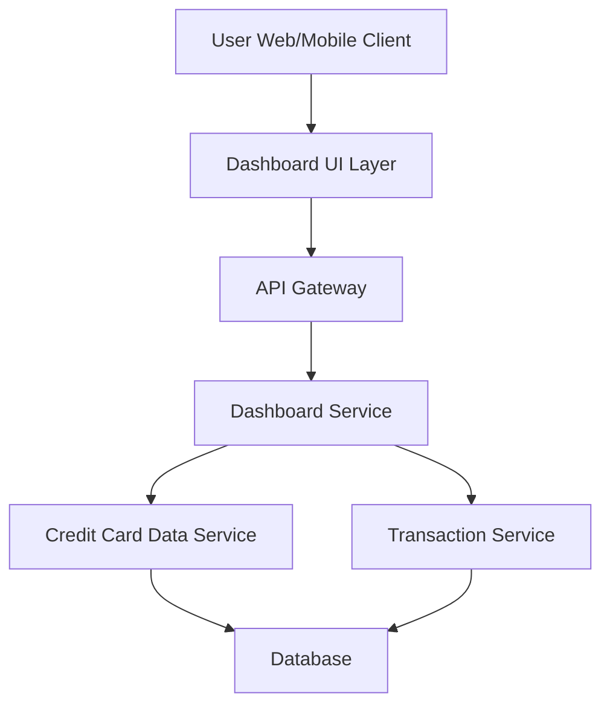

#### 1. High-Level Design

- **Summary:** This epic delivers a consolidated dashboard that aggregates and displays key performance indicators (KPIs) for a user's credit card portfolio. The dashboard provides real-time visibility into monthly spend, total credit limit, available credit, and outstanding amounts, enabling users to monitor their overall credit card health from a single responsive interface.

- **Component Flow:**

- **Integration Points:**
  - **Upstream:** Credit Card Data Service (retrieves card details, balances, credit limits)
  - **Upstream:** Transaction Service (calculates monthly spend and outstanding amounts)
  - **Downstream:** User Web/Mobile Client (renders dashboard with KPIs)

- **Key Assumptions:**
  - KPI data is refreshed on-demand when the user accesses the dashboard; real-time refresh implies API-driven polling or WebSocket for live updates.
  - Monthly spend is calculated based on the current calendar month; outstanding amounts represent the sum of unpaid transactions.

- **NFR Highlights:** Dashboard must be responsive across desktop, tablet, and mobile devices; page load time under 2 seconds; support real-time data refresh for KPI metrics.

- **Data Flow:** User accesses the dashboard via web or mobile client. The Dashboard UI Layer requests KPI data through the API Gateway, which routes the request to the Dashboard Service. The Dashboard Service aggregates data by calling the Credit Card Data Service (for credit limits, available credit, card details) and the Transaction Service (for monthly spend and outstanding amounts). Both services query the Database for relevant information. Aggregated KPI data is returned to the Dashboard Service, which formats and sends it back through the API Gateway to the UI Layer for display.

#### 2. Validation Report

- **Requirements Coverage:** The design fully covers the epic's stated scope, including dashboard KPI display, monthly spend calculation, total credit limit aggregation, available credit calculation, outstanding amount tracking, and responsive layout. All NFRs (responsiveness, page load time under 2 seconds, real-time data refresh) are addressed through the component architecture and service integration. The design supports the user value by providing instant visibility into credit utilization and financial position through the consolidated dashboard interface.