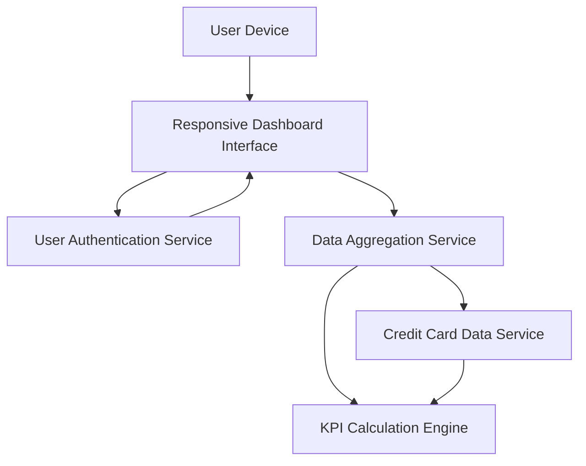

#### 1. High-Level Design

- **Summary**: This epic develops a consolidated dashboard serving as the primary landing page and central hub for credit card management. Users view critical financial metrics (monthly spend, total credit limit, available credit, outstanding amounts) across all cards in a single interface. The dashboard loads within 2 seconds, supports responsive design across all devices, and provides near real-time data refresh for comprehensive portfolio health assessment.

- **Component Flow**:

- **Integration Points**: 
  - **Upstream**: Credit card data service (for retrieving card details and balances), User authentication service (for secure access)
  - **Downstream**: Data aggregation service (for calculating KPIs across multiple cards), KPI Calculation Engine (for metric computation)

- **Key Assumptions**: 
  - Near real-time data refresh is achieved through efficient caching and periodic synchronization with the credit card data service.
  - KPI calculations are optimized to complete within the 2-second load time requirement even for users with multiple cards.

- **NFR Highlights**: Dashboard must load within 2 seconds; system must support responsive design across desktop, tablet, and mobile devices; data refresh rate must be near real-time or within acceptable latency for user experience.

- **Data Flow**: User accesses dashboard → User Authentication Service validates credentials → Responsive Dashboard Interface requests aggregated data from Data Aggregation Service → Service queries Credit Card Data Service for all user's card details → KPI Calculation Engine computes monthly spend, total credit limit, available credit, and outstanding amounts → Aggregated KPIs are returned to dashboard → Dashboard displays consolidated multi-card overview with responsive layout → User views overall credit card portfolio health at a glance with near real-time data.

#### 2. Validation Report

- **Requirements Coverage**: The design comprehensively addresses dashboard interface development, monthly spend KPI display, total credit limit aggregation, available credit calculation and display, outstanding amount tracking, multiple credit card view integration, and responsive layout implementation. All NFRs (2-second load time, responsive design across devices, near real-time refresh) are fully incorporated into the architecture and component design.