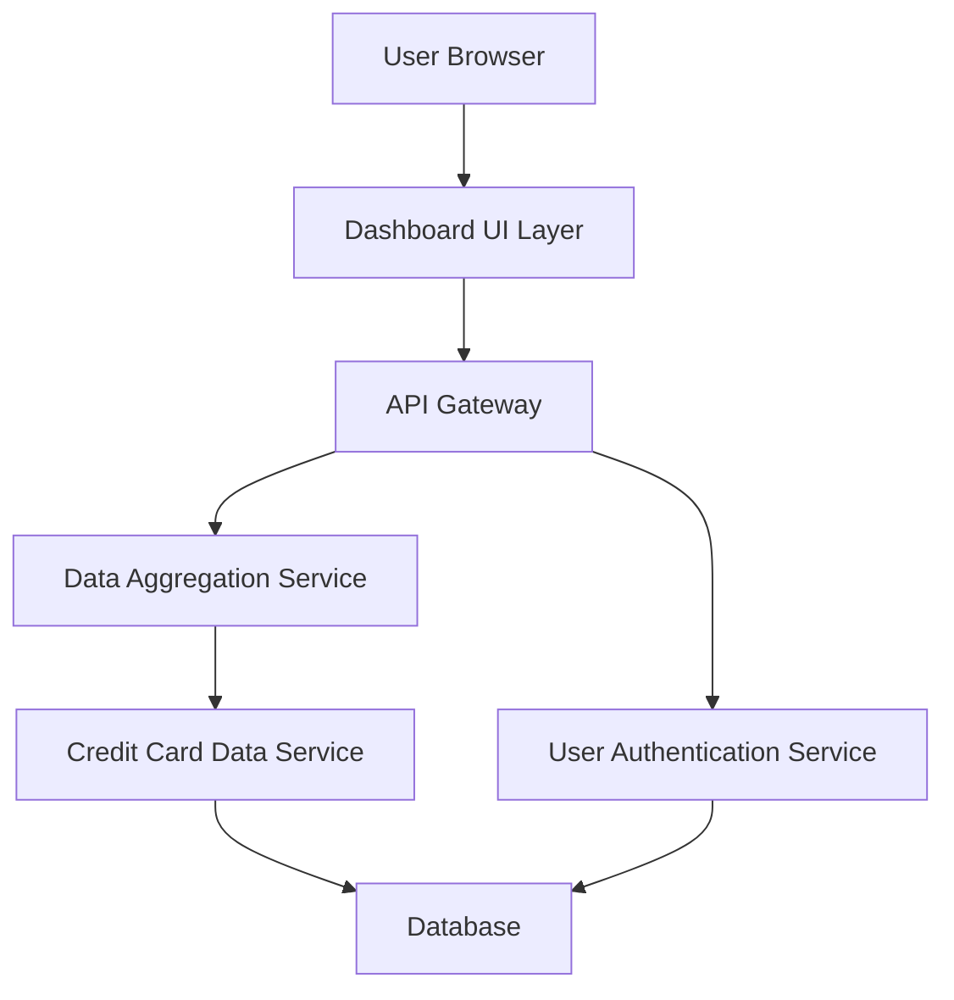

#### 1. High-Level Design

- **Summary:** This epic delivers a consolidated dashboard serving as the primary landing page for credit card management. It aggregates and displays key performance indicators (KPIs) including monthly spend, total credit limit, available credit, and outstanding amounts across all user credit cards, providing a comprehensive portfolio overview in a single interface.

- **Component Flow:**

- **Integration Points:**
  - **Upstream:** User Authentication Service for secure user access and session management
  - **Downstream:** Credit Card Data Service for retrieving card details, balances, and limits
  - **Downstream:** Data Aggregation Service for calculating KPIs across multiple cards

- **Key Assumptions:** 
  - Credit card data is available via RESTful API with JSON format from backend services
  - KPI calculations are performed server-side with cached results to meet the 2-second load time requirement

- **NFR Highlights:** Dashboard must load within 2 seconds; must support responsive design across desktop, tablet, and mobile devices; data refresh rate must be near real-time or within acceptable latency for user experience

- **Data Flow:** User authenticates via Authentication Service → Dashboard UI requests aggregated data via API Gateway → Data Aggregation Service fetches credit card details from Credit Card Data Service → Service queries Database for card balances, limits, and transaction summaries → Aggregated KPIs (monthly spend, total credit limit, available credit, outstanding amounts) are calculated and returned → Dashboard UI renders responsive layout displaying all KPIs and credit card overview

#### 2. Validation Report

- **Requirements Coverage:** The design fully covers the epic's stated scope including dashboard interface development, KPI displays (monthly spend, total credit limit, available credit, outstanding amount), multiple credit card view integration, and responsive layout implementation. All specified NFRs (2-second load time, responsive design, near real-time data refresh) are addressed through architectural choices including server-side aggregation, caching strategies, and API-based data retrieval. All identified dependencies (Credit Card Data Service, User Authentication Service, Data Aggregation Service) are incorporated into the component flow.