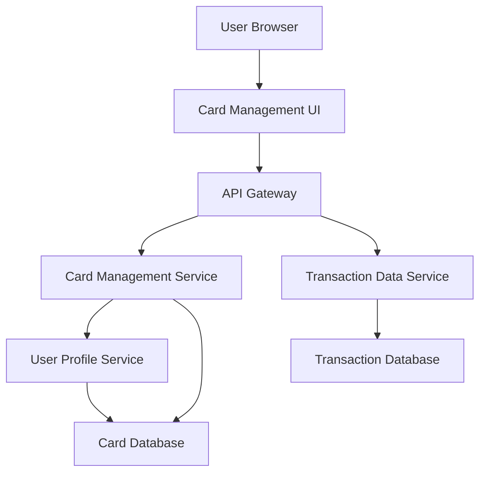

#### 1. High-Level Design

- **Summary:** This epic enables users to manage multiple credit cards and view detailed transaction histories within the dashboard. It provides card-centric views allowing users to drill down into specific card performance, transaction records, and card details, supporting granular financial tracking and reconciliation across up to 50 credit cards with multi-year transaction histories.

- **Component Flow:**

- **Integration Points:**
  - **Upstream:** User Profile Service for card ownership validation and user-card association
  - **Downstream:** Transaction Data Service for retrieving card-specific transactions with pagination support
  - **Downstream:** Credit Card Information Service for card details, metadata, limits, and status

- **Key Assumptions:** 
  - Transaction data is stored with indexed card identifiers to enable efficient card-wise filtering
  - Pagination is implemented with default page size of 50 transactions to handle large datasets efficiently

- **NFR Highlights:** System must handle display of transactions for users with up to 50 credit cards; transaction retrieval must support pagination for large datasets; interface must maintain performance with transaction histories spanning multiple years

- **Data Flow:** User selects a credit card from the dashboard → Card Management UI requests card details via API Gateway → Card Management Service validates ownership through User Profile Service and retrieves card metadata from Card Database → User requests transaction history → Transaction Data Service queries Transaction Database with card identifier and pagination parameters → Paginated transaction records are returned and displayed → User can filter by card, view individual card details, and navigate through transaction history pages

#### 2. Validation Report

- **Requirements Coverage:** The design comprehensively covers the epic's scope including multiple credit card display and management, individual card detail views, transaction listing and display, card-wise filtering capabilities, transaction history tracking, and card information management. All NFRs are addressed through architectural patterns: pagination support for large datasets, indexed database queries for multi-year transaction histories, and scalable service architecture for up to 50 cards per user. All dependencies (Transaction Data Service, Credit Card Information Service, User Profile Service) are integrated into the component flow with clear ownership validation and data retrieval patterns.