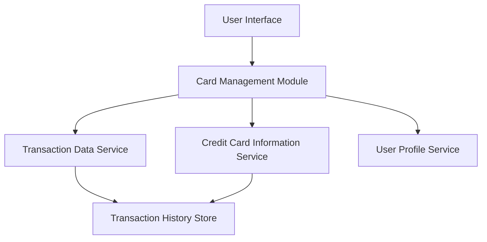

#### 1. High-Level Design

- **Summary**: This epic enables users to manage multiple credit cards and view detailed transaction histories within the dashboard. Users can add, view, and monitor individual cards with specific details, limits, and transaction records. The system provides card-centric views with drill-down capabilities for detailed financial tracking and reconciliation, supporting up to 50 credit cards per user with paginated transaction display.

- **Component Flow**:

- **Integration Points**: 
  - **Upstream**: Transaction data service (for retrieving card transactions), Credit card information service (for card details and metadata), User profile service (for card ownership validation)
  - **Downstream**: Card Management Module (for orchestrating card and transaction display)

- **Key Assumptions**: 
  - Transaction data is available with sufficient metadata (date, amount, merchant, category) for meaningful display and filtering.
  - Pagination is implemented at the service layer to handle large transaction datasets efficiently.

- **NFR Highlights**: System must handle display of transactions for users with up to 50 credit cards; transaction retrieval must support pagination for large datasets; interface must maintain performance with transaction histories spanning multiple years.

- **Data Flow**: User selects card management view → Card Management Module queries User Profile Service to validate ownership → Module retrieves card details from Credit Card Information Service → User selects specific card for drill-down → Transaction Data Service fetches paginated transaction history from Transaction History Store → Transactions are displayed with filtering and sorting capabilities → User views detailed card-specific transaction records for tracking and reconciliation.

#### 2. Validation Report

- **Requirements Coverage**: The design covers all scope elements including multiple credit card display and management, individual card detail views, transaction listing and display, card-wise filtering capabilities, transaction history tracking, and card information management. All NFRs (50 cards support, pagination for large datasets, multi-year performance) are addressed through the modular architecture and service integration.