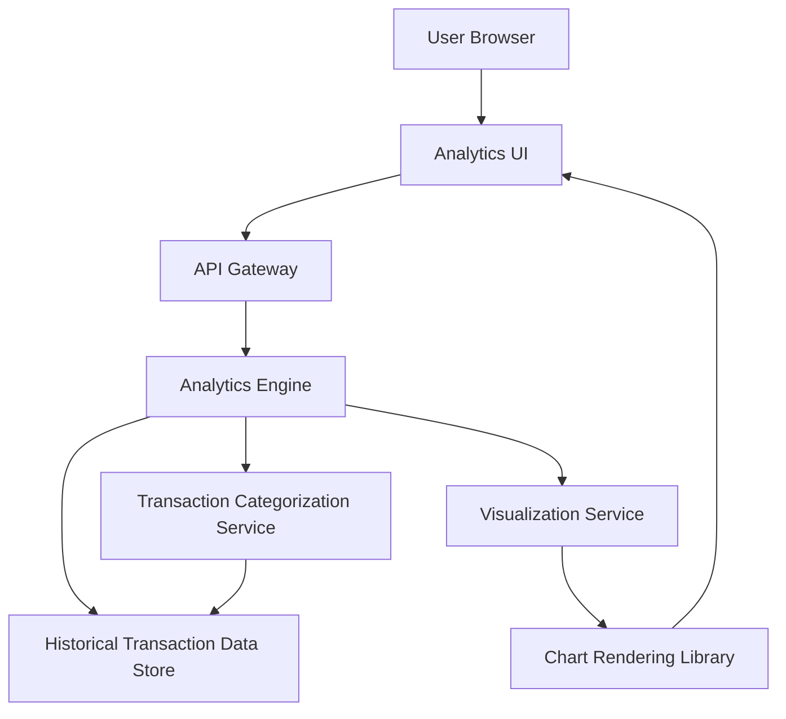

#### 1. High-Level Design

- **Summary:** This epic delivers comprehensive analytics and visualization capabilities that transform raw transaction data into actionable financial insights. It provides interactive visualizations for monthly spend trends, card-wise spend analysis, and category-wise spending breakdowns across nine predefined categories, enabling users to identify spending patterns and make data-driven financial decisions.

- **Component Flow:**

- **Integration Points:**
  - **Upstream:** Historical Transaction Data Store for accessing transaction records with category metadata
  - **Downstream:** Transaction Categorization Service for classifying expenses into nine categories (Food & Dining, Fuel, Shopping, Travel, Entertainment, Utilities, Healthcare, Education, Miscellaneous)
  - **Downstream:** Visualization Library for rendering interactive charts and graphs
  - **Downstream:** Analytics Engine for data processing, aggregation, and trend analysis

- **Key Assumptions:** 
  - Transactions are pre-categorized or categorized in near real-time to meet the 3-second calculation requirement
  - Analytics calculations leverage pre-aggregated summary tables or materialized views for performance optimization

- **NFR Highlights:** Analytics calculations must complete within 3 seconds for datasets up to 10,000 transactions; visualizations must render smoothly on all supported devices; system must support real-time or near real-time data aggregation for analytics

- **Data Flow:** User accesses analytics dashboard → Analytics UI requests spending insights via API Gateway → Analytics Engine queries Historical Transaction Data Store for transaction records → Transaction Categorization Service ensures all transactions are classified into one of nine categories → Analytics Engine performs aggregations for monthly trends, card-wise spend, and category-wise breakdowns → Processed data is sent to Visualization Service → Chart Rendering Library generates interactive charts and graphs → Rendered visualizations are displayed in Analytics UI with smooth performance across devices

#### 2. Validation Report

- **Requirements Coverage:** The design fully addresses the epic's scope including monthly spend trend visualization, card-wise spend analysis, category-wise spending breakdown across all nine specified categories, interactive charts and graphs, spending pattern identification, and time-based trend analysis. All NFRs are met through architectural decisions: pre-aggregation and optimized queries for 3-second calculation time, responsive visualization library for smooth rendering across devices, and near real-time data aggregation through the Analytics Engine. All dependencies (Transaction Categorization Service, Analytics Engine, Visualization Library, Historical Transaction Data Store) are incorporated with clear data processing and rendering pipelines. The design explicitly excludes out-of-scope items (predictive analytics, budget recommendations) as specified.