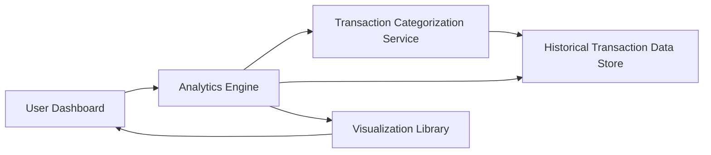

#### 1. High-Level Design

- **Summary**: This epic transforms raw transaction data into actionable financial insights through comprehensive analytics and visualization capabilities. Users access interactive visualizations showing monthly spend trends, card-wise spend analysis, and category-wise breakdowns across nine categories. The analytics engine processes up to 10,000 transactions within 3 seconds, identifying spending patterns and trends to enable data-driven financial decisions.

- **Component Flow**:

- **Integration Points**: 
  - **Upstream**: Transaction categorization service (for classifying expenses), Historical transaction data store (for retrieving transaction records)
  - **Downstream**: Analytics engine (for data processing and aggregation), Visualization library (for rendering charts and graphs)

- **Key Assumptions**: 
  - Transaction categorization service provides accurate automated classification into the nine predefined categories with minimal manual intervention required.
  - Historical transaction data is stored in a format optimized for fast aggregation and analytics queries.

- **NFR Highlights**: Analytics calculations must complete within 3 seconds for datasets up to 10,000 transactions; visualizations must render smoothly on all supported devices; system must support real-time or near real-time data aggregation for analytics.

- **Data Flow**: User requests spending insights → Analytics Engine retrieves transactions from Historical Transaction Data Store → Transaction Categorization Service classifies expenses into nine categories → Analytics Engine aggregates data by month, card, and category → Processed insights are formatted for visualization → Visualization Library renders interactive charts (monthly trends, card-wise analysis, category breakdowns) → User views and interacts with spending patterns and trends.

#### 2. Validation Report

- **Requirements Coverage**: The design fully addresses monthly spend trend visualization, card-wise spend analysis, category-wise spending breakdown, interactive charts and graphs, spending pattern identification across all nine categories, and time-based trend analysis. All NFRs (3-second calculation time for 10K transactions, smooth rendering, real-time aggregation) are incorporated into the component design.