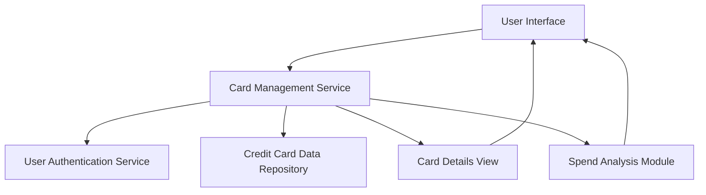

#### 1. High-Level Design

- **Summary:** This epic enables users to manage and view multiple credit cards within the dashboard. The core requirement is to provide a consolidated interface for viewing all registered credit cards, switching between cards, accessing card-specific details, and performing card-wise spend analysis. The system must support up to 50 credit cards per user with secure display of card information (masked card numbers) and fast card switching (<500ms).

- **Component Flow:**

- **Integration Points:** 
  - **Upstream:** User authentication service for card ownership verification and access control
  - **Upstream:** Credit card data repository for storing and retrieving card information, card details, and metadata
  - **Internal:** Spend analysis module for card-wise spend analysis (may integrate with transaction analytics from QE-8617)

- **Key Assumptions:** 
  - Card ownership is verified through the user authentication service; each card is associated with a specific user account and access is controlled at the service level.
  - Card information includes card identifiers, labels, issuer details, and metadata; sensitive card numbers are stored securely and displayed in masked format (e.g., **** **** **** 1234).

- **NFR Highlights:** System must support display of up to 50 credit cards per user; Card switching response time must be under 500ms; Secure display of card information with masked card numbers.

- **Data Flow:** User logs in and accesses card management interface → User Authentication Service verifies ownership → Card Management Service retrieves list of user's cards from Credit Card Data Repository → UI displays card listing with masked card numbers and labels → User selects a specific card → Card Management Service retrieves detailed card information (<500ms) → Card Details View displays individual card details → User requests card-wise spend analysis → Spend Analysis Module retrieves and displays card-specific spending data → User can switch between cards with fast response time.

#### 2. Validation Report

- **Requirements Coverage:** The design fully covers the epic's stated scope including multiple credit card display, card listing interface, card selection and switching, card-wise spend analysis, individual card details view, and card identification and labeling. The architecture supports all NFRs for displaying up to 50 cards per user, card switching response time under 500ms (optimized through efficient data retrieval), and secure display with masked card numbers. Integration with user authentication service for ownership verification and credit card data repository is addressed. The design excludes out-of-scope items (real bank integration, card payments, fund transfers, adding new physical cards, card activation/deactivation) as specified.