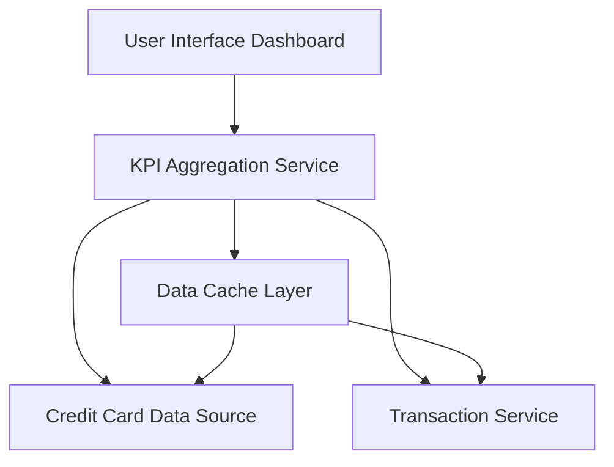

#### 1. High-Level Design

- **Summary:** This epic delivers a consolidated dashboard displaying key performance indicators (KPIs) for the user's credit card portfolio. The core requirement is to provide real-time visibility into critical financial metrics: monthly spend, total credit limit, available credit, and outstanding amounts across all credit cards. The dashboard must be responsive across all devices and provide real-time data refresh capabilities.

- **Component Flow:**

- **Integration Points:** 
  - **Upstream:** Credit card data source or mock data service for retrieving card balances, credit limits, and account information
  - **Upstream:** Transaction service for retrieving monthly spend and outstanding amount data
  - **Internal:** Data cache layer for real-time data refresh and performance optimization

- **Key Assumptions:** 
  - Credit card data source provides real-time or near-real-time data for balances, limits, and outstanding amounts; API response time supports the 2-second page load requirement.
  - Monthly spend is calculated from transaction data aggregated within the current billing cycle or calendar month.

- **NFR Highlights:** Dashboard must be responsive across desktop, tablet, and mobile devices; Page load time must be under 2 seconds; Support real-time data refresh for KPI metrics.

- **Data Flow:** User accesses dashboard → UI requests KPI data from KPI Aggregation Service → Service retrieves card balances and limits from Credit Card Data Source → Service retrieves transaction data from Transaction Service → Cache Layer optimizes repeated requests → Service calculates aggregated KPIs (total credit limit, available credit, monthly spend, outstanding amounts) → Aggregated KPIs are returned to UI → Dashboard displays consolidated metrics with real-time refresh capability.

#### 2. Validation Report

- **Requirements Coverage:** The design fully covers the epic's stated scope including dashboard KPIs display, monthly spend tracking, total credit limit calculation, available credit display, outstanding amount tracking, responsive layout design, and multi-card consolidated view. The architecture supports all NFRs for responsive design across devices, page load time under 2 seconds (supported by cache layer), and real-time data refresh. Integration with credit card data source and transaction service is addressed. The design explicitly excludes out-of-scope items (real bank integration, card payments, fund transfers, loans, payment gateway integration) as specified.