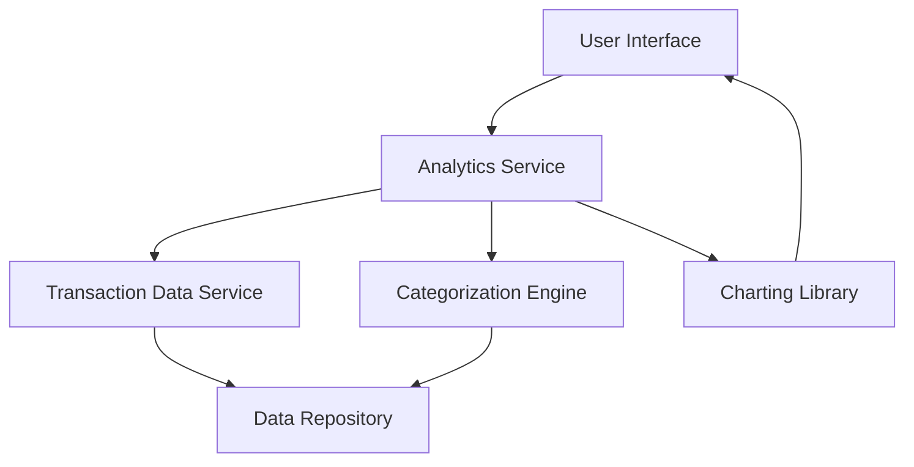

#### 1. High-Level Design

- **Summary:** This epic delivers comprehensive transaction analytics and spending insights for credit card users. The core requirement is to provide users with visual analytics across nine spending categories (Food & Dining, Fuel, Shopping, Travel, Entertainment, Utilities, Healthcare, Education, Miscellaneous), monthly spend trends, and card-wise breakdowns through interactive charts and graphs. The scope covers historical analysis for at least 12 months with responsive visualizations.

- **Component Flow:**

- **Integration Points:** 
  - **Upstream:** Transaction data service for retrieving transaction history
  - **Upstream:** Categorization engine or service for transaction classification into nine spending categories
  - **External:** Charting library for visualization rendering (e.g., Chart.js, D3.js, or similar)
  - **Upstream:** Credit card data repository for historical transaction data

- **Key Assumptions:** 
  - Transaction categorization is either pre-classified by the transaction data service or will be performed by a rule-based/ML categorization engine; categories are limited to the nine specified types.
  - Historical transaction data for at least 12 months is available and accessible through the transaction data service API.

- **NFR Highlights:** Analytics visualizations must render within 1 second; Support historical data analysis for at least 12 months; Charts must be interactive and responsive across all device sizes (desktop, tablet, mobile).

- **Data Flow:** User requests spending analytics through the UI → Analytics Service retrieves raw transaction data from Transaction Data Service → Categorization Engine classifies transactions into nine categories → Analytics Service aggregates data by category, time period, and card → Processed data is formatted for visualization → Charting Library renders interactive charts/graphs → User interacts with visualizations to explore spending patterns and trends.

#### 2. Validation Report

- **Requirements Coverage:** The design fully covers the epic's stated scope including category-wise spending visualization, monthly trend analysis, interactive charts, transaction categorization across all nine categories, spending pattern identification, and card-wise spend breakdown. The architecture supports the NFRs for rendering performance (<1 second), historical data retention (12 months), and responsive design. All integration points with transaction data service, categorization engine, and charting library are addressed. The design excludes out-of-scope items (real bank integration, payment gateway, transaction dispute management, transaction editing/deletion, predictive forecasts) as specified.