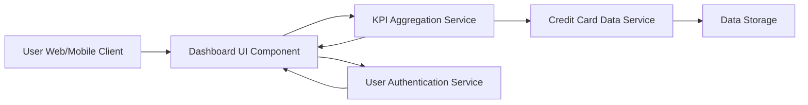

#### 1. High-Level Design

- **Summary**: This epic delivers a consolidated dashboard that displays key performance indicators (KPIs) for credit card usage, including monthly spend, total credit limit, available credit, and outstanding amounts. The dashboard provides real-time financial visibility to help users make informed decisions about their credit card spending and financial health.

- **Component Flow**:

- **Integration Points**: 
  - **Upstream**: User Authentication Service (for secure user access)
  - **Downstream**: Credit Card Data Service (for retrieving card balances and transaction data)
  - Data Storage Service (for persistent storage of credit card and transaction information)

- **Key Assumptions**: 
  - KPI calculations (available credit, outstanding amounts) are computed server-side and cached for performance
  - Real-time updates refer to near-real-time (within acceptable latency thresholds) rather than true streaming data

- **NFR Highlights**: Dashboard must load within 2 seconds, support responsive design across desktop and mobile devices, handle real-time data updates for KPI metrics

- **Data Flow**: User authenticates via Authentication Service → Dashboard UI requests KPI data → KPI Aggregation Service fetches card balances and transaction data from Credit Card Data Service → Data is aggregated (monthly spend, total limit, available credit, outstanding amount) → Formatted KPI metrics returned to Dashboard UI → User views consolidated financial snapshot with real-time updates

#### 2. Validation Report

- **Requirements Coverage**: The design fully covers the epic's stated scope including monthly spend tracking, total credit limit display, available credit calculation, outstanding amount monitoring, and responsive dashboard layout. All NFRs (2-second load time, responsive design, real-time updates) are addressed through the KPI Aggregation Service architecture and caching strategy. Integration dependencies with Credit Card Data Service and User Authentication Service are incorporated into the component flow.