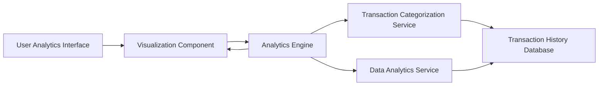

#### 1. High-Level Design

- **Summary**: This epic delivers interactive visualizations and analytics to help users understand spending patterns across categories and time periods. Users can analyze monthly spend trends and view category-wise breakdowns across nine predefined categories (Food & Dining, Fuel, Shopping, Travel, Entertainment, Utilities, Healthcare, Education, Miscellaneous), enabling data-driven insights for better financial decisions.

- **Component Flow**:

- **Integration Points**: 
  - **Upstream**: Transaction History Database (for historical transaction data, minimum 12 months)
  - **Downstream**: Transaction Categorization Service (for automatic category assignment)
  - Data Analytics Engine (for trend calculation and pattern identification)
  - Visualization Library (for rendering interactive charts and graphs)

- **Key Assumptions**: 
  - Transaction categorization is automated using predefined rules/ML models and applied during transaction ingestion
  - Historical data aggregation is pre-computed for common time periods (monthly, quarterly) to optimize rendering performance

- **NFR Highlights**: Analytics visualizations must render within 2 seconds, support interactive filtering and drill-down capabilities, handle minimum 12 months of historical transaction data

- **Data Flow**: User accesses analytics interface → Analytics Engine requests categorized transaction data from Transaction Categorization Service → Service retrieves transactions from Transaction History Database (12+ months) → Data Analytics Service computes monthly trends and category-wise aggregations → Processed analytics data returned to Analytics Engine → Visualization Component renders interactive charts/graphs with filtering capabilities → User interacts with visualizations to drill down into spending patterns across nine categories and time periods

#### 2. Validation Report

- **Requirements Coverage**: The design fully addresses the epic's scope including monthly spend trend visualization, category-wise spending analysis across nine predefined categories, interactive charts and graphs, spending pattern identification, and historical data analysis. All NFRs (2-second rendering, interactive filtering/drill-down, 12 months historical data) are supported through the Analytics Engine architecture with pre-computed aggregations and visualization library integration. All integration dependencies (Transaction Categorization Service, Data Analytics Engine, Transaction History Database, Visualization Library) are incorporated into the component flow.