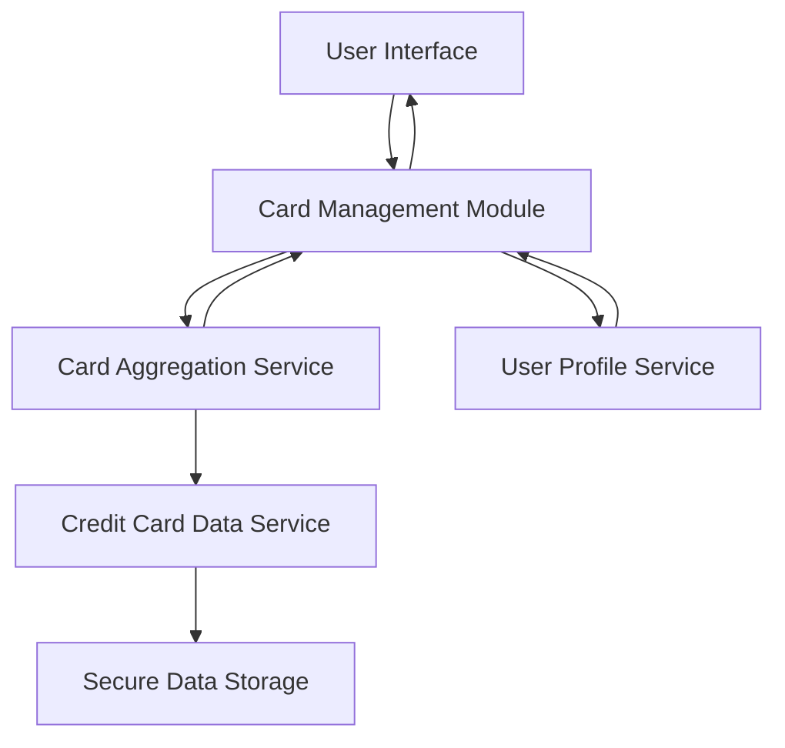

#### 1. High-Level Design

- **Summary**: This epic provides a unified interface for users to manage and monitor multiple credit cards simultaneously. Users can view all their cards, access card-specific details (credit limits, balances, spending patterns), perform card-wise spend analysis, and compare performance across different cards to make strategic purchasing decisions.

- **Component Flow**:

- **Integration Points**: 
  - **Upstream**: User Profile Service (for card ownership validation)
  - **Downstream**: Credit Card Data Aggregation Service (for retrieving multi-card data)
  - Secure Data Storage Service (for encrypted card information storage with data isolation)

- **Key Assumptions**: 
  - Card data aggregation occurs asynchronously with results cached to meet 3-second retrieval requirement
  - Card comparison logic is implemented client-side for interactive performance once data is loaded

- **NFR Highlights**: System must support minimum 10 credit cards per user, card data retrieval must complete within 3 seconds, ensure data isolation and security for each card

- **Data Flow**: User accesses card management interface → User Profile Service validates card ownership → Card Aggregation Service retrieves data for all user's cards from Credit Card Data Service → Individual card details (limits, balances, spending patterns) fetched from Secure Data Storage with data isolation → Aggregated multi-card data returned to Card Management Module → User views all cards in unified interface with card-wise analysis and comparison capabilities

#### 2. Validation Report

- **Requirements Coverage**: The design comprehensively addresses all scope elements including multiple credit card display, card-wise spend analysis, individual card details view, card-specific tracking, and card comparison capabilities. NFRs for supporting 10+ cards per user, 3-second retrieval time, and data isolation/security are met through the Card Aggregation Service architecture and Secure Data Storage with encryption. All integration dependencies (Credit Card Data Aggregation Service, User Profile Service, Secure Data Storage) are incorporated into the design.