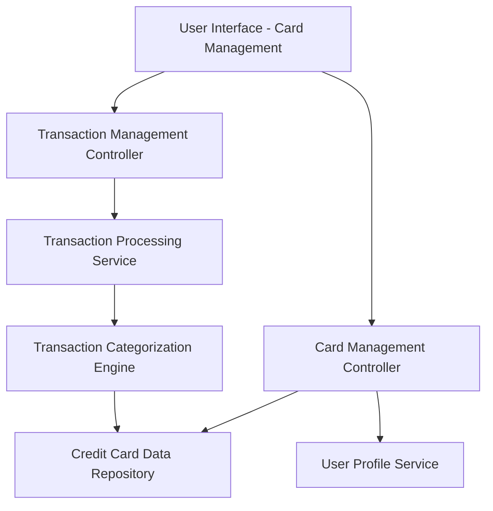

#### 1. High-Level Design

**Summary:** This epic enables users to manage their credit card portfolio and view associated transaction details. Users can add, view, and monitor multiple credit cards, access detailed transaction histories, and track individual card performance. This capability serves as the foundational data management layer for the dashboard and analytics features, ensuring accurate and consistent card and transaction data across the system.

**Component Flow:**

**Integration Points:**
- **Upstream:** User profile service (for user identification and authorization to manage cards)
- **Downstream:** Credit card data repository (persistent storage for card details and metadata)
- **Downstream:** Transaction processing service (retrieves and processes transaction records)
- **Internal:** Transaction categorization engine (assigns categories to transactions for analytics)

**Key Assumptions:**
- Card addition process involves manual entry of card details by users; automated integration with financial institutions for card import is out of scope.
- Transaction data is sourced from an existing transaction processing service; the mechanism for initial transaction ingestion (batch, real-time feed) is not specified but assumed to be operational.

**NFR Highlights:** Support minimum 10 credit cards per user; transaction list pagination for performance; search and filter operations must complete within 1 second; data accuracy and consistency across all card records.

#### 2. Validation Report

**Requirements Coverage:** The design comprehensively covers all scope elements including multiple credit card management, transaction listing and viewing, card details display, transaction history tracking, card addition and configuration, and transaction categorization. The architecture establishes clear separation between card management and transaction management controllers, with dedicated services for data persistence, transaction processing, and categorization. All NFRs (10+ cards per user, pagination, 1-second search/filter, data consistency) are architecturally supported through scalable repository design, indexed data structures for fast retrieval, and transaction management patterns ensuring data integrity.