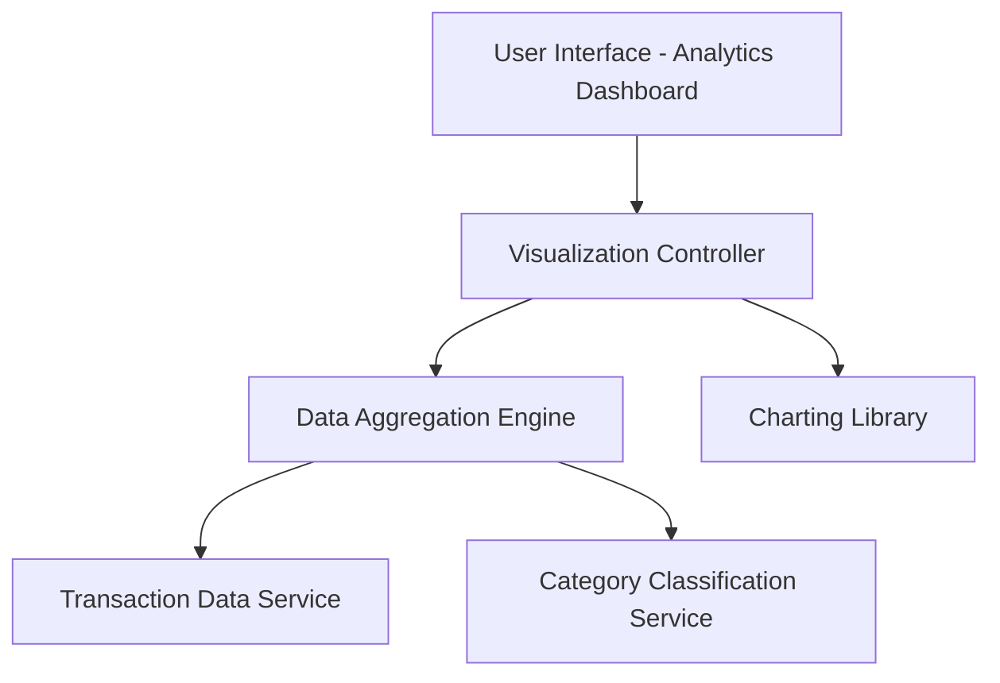

#### 1. High-Level Design

**Summary:** This epic provides interactive analytics and visualization capabilities enabling users to analyze spending patterns through category-wise breakdowns and monthly trend analysis. Users can explore spending across nine predefined categories (Food & Dining, Fuel, Shopping, Travel, Entertainment, Utilities, Healthcare, Education, Miscellaneous), perform card-wise spend comparisons, and visualize trends over time through interactive charts and graphs.

**Component Flow:**

**Integration Points:**
- **Upstream:** Transaction data service (provides raw transaction data for analysis and aggregation)
- **Upstream:** Data aggregation engine (processes and summarizes transaction data by category, card, and time period)
- **External:** Charting/visualization library (third-party or internal library for rendering interactive charts)

**Key Assumptions:**
- Transactions are pre-categorized or categorization logic exists to map transactions to the nine predefined categories; manual categorization by users is not addressed in this epic.
- Historical data retention supports at least 12 months of transaction history for trend analysis; data archival and purging policies are assumed to be managed separately.

**NFR Highlights:** Visualization rendering must complete within 3 seconds; support interactive chart interactions with smooth transitions; handle data aggregation for up to 12 months of historical spending data.

#### 2. Validation Report

**Requirements Coverage:** The design addresses all scope elements including category-wise spending visualization, monthly spend trend charts, card-wise spend analysis, interactive data visualizations, nine spending categories tracking, and comparative spending analytics. The architecture separates concerns between data aggregation, transaction retrieval, category classification, and visualization rendering, ensuring modularity and performance. All NFRs (3-second rendering, interactive charts, 12-month data handling) are supported through optimized aggregation and efficient charting library integration.