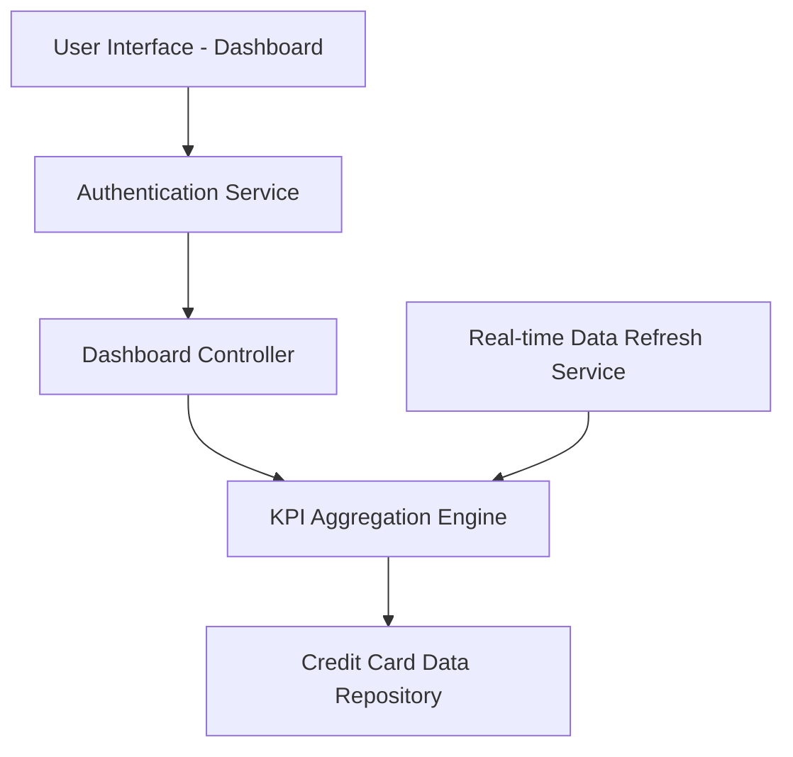

#### 1. High-Level Design

**Summary:** This epic delivers a consolidated dashboard that displays key performance indicators (KPIs) for all user credit cards in a single, responsive interface. The dashboard aggregates and presents critical financial metrics including monthly spend, total credit limit, available credit, and outstanding amounts, providing users with real-time visibility into their credit card portfolio and overall financial health.

**Component Flow:**

**Integration Points:**
- **Upstream:** User authentication service (for user identity verification and session management)
- **Downstream:** Credit card data source/repository (for retrieving card details, balances, limits, and transaction summaries)

**Key Assumptions:**
- Credit card data is updated in near real-time (within acceptable latency) from the data repository; exact refresh frequency not specified but assumed to be sufficient for "real-time" KPI updates.
- KPI calculations (available credit, outstanding amounts) follow standard financial formulas; specific business rules for aggregation across multiple cards are assumed to be straightforward summation.

**NFR Highlights:** Dashboard must load within 2 seconds; support responsive design for mobile, tablet, and desktop devices; handle real-time data refresh for KPI updates.

#### 2. Validation Report

**Requirements Coverage:** The design covers all stated scope elements including dashboard KPI display, monthly spend tracking, total credit limit aggregation, available credit calculation, outstanding amount monitoring, multiple credit card view, and responsive layout implementation. The component flow ensures data flows from the repository through aggregation to the UI layer, with authentication and real-time refresh capabilities integrated. All specified NFRs (2-second load time, responsive design, real-time refresh) are architecturally supported through dedicated services and optimized data retrieval patterns.