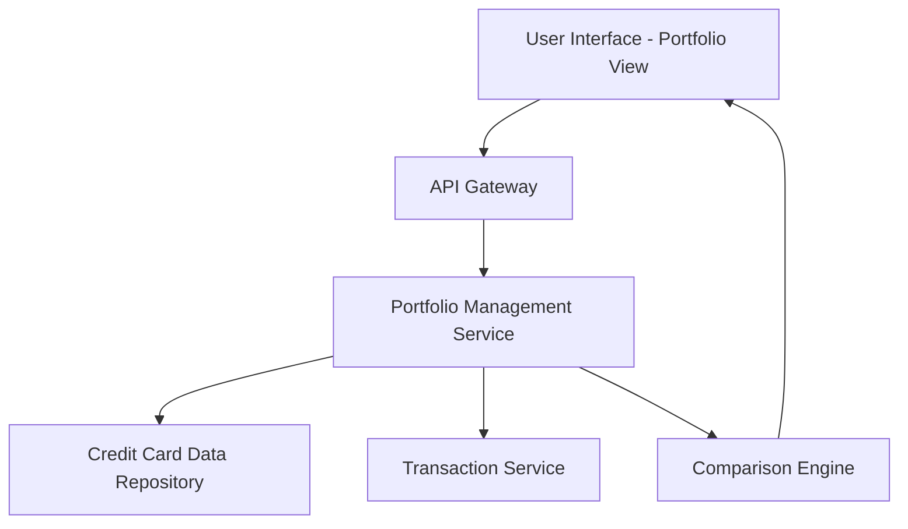

#### 1. High-Level Design

- **Summary**: This epic enables users to view and manage multiple credit cards within a unified interface. Users can see all their cards with individual details, monitor card-specific spending patterns, and compare performance across their portfolio. The feature provides a consolidated view for simplified tracking and comparison.

- **Component Flow**:

- **Integration Points**: 
  - **Upstream**: Credit card data repository (for storing and retrieving card information), Transaction service (for card-wise spending data)
  - **Downstream**: Portfolio View UI (multi-card display and comparison interface)

- **Key Assumptions**: 
  - User authentication and card ownership validation are handled by an external identity/authorization service (not detailed in epic).
  - Card data repository supports efficient querying for multiple cards per user without requiring denormalization.

- **NFR Highlights**: System must support display of multiple cards per user without performance degradation; UI must maintain responsiveness when displaying large numbers of cards; Data integrity must be maintained across all card records.

- **Data Flow**: User accesses the portfolio management interface. The API Gateway routes requests to the Portfolio Management Service, which retrieves all credit cards associated with the user from the Credit Card Data Repository. For each card, the service fetches card-specific spending data from the Transaction Service. The Comparison Engine processes card details and spending patterns to enable side-by-side comparison. The consolidated portfolio data, including individual card details and comparative metrics, is returned to the UI for display.

#### 2. Validation Report

- **Requirements Coverage**: The design fully covers the stated scope: multiple credit card display, individual card details view, card-wise spend analysis, card comparison capabilities, and card portfolio overview. The architecture ensures performance is maintained when displaying multiple cards, UI responsiveness is preserved regardless of card count, and data integrity is enforced through the Credit Card Data Repository, all aligning with specified NFRs. Integration dependencies with the credit card data repository and transaction service are incorporated into the service layer.