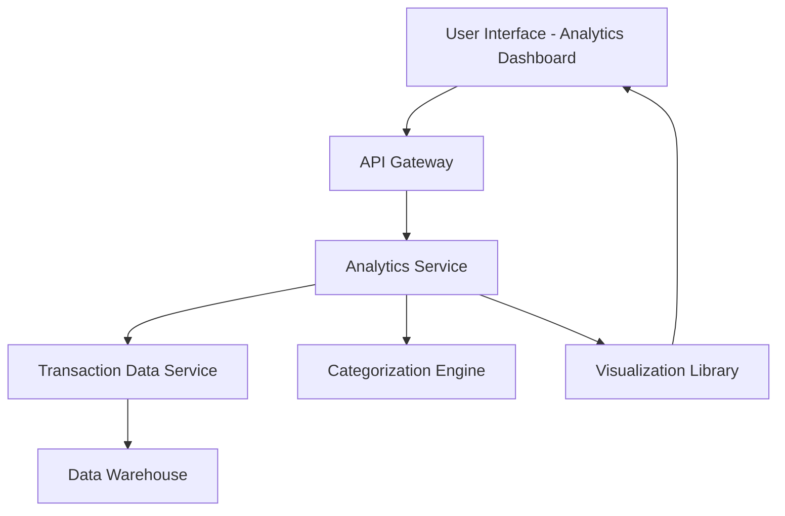

#### 1. High-Level Design

- **Summary**: This epic provides interactive visualizations and analytics for users to understand spending patterns across predefined categories (Food & Dining, Fuel, Shopping, Travel, Entertainment, Utilities, Healthcare, Education, Miscellaneous). It includes monthly spend trend analysis with interactive charts to support data-driven financial decision-making.

- **Component Flow**:

- **Integration Points**: 
  - **Upstream**: Transaction data service (for historical spending data), Categorization engine (for transaction classification), Visualization library (for chart rendering)
  - **Downstream**: Analytics Dashboard UI (interactive charts and graphs)

- **Key Assumptions**: 
  - Transaction categorization is performed by an automated engine with predefined rules; manual recategorization is not in scope.
  - Historical data for trend analysis is available for at least 12 months (timeframe not specified in epic).

- **NFR Highlights**: Analytics visualizations must load within acceptable response times; System must handle large transaction volumes for trend analysis; Charts must be interactive and responsive across all device types.

- **Data Flow**: User accesses the analytics dashboard. The API Gateway routes requests to the Analytics Service, which retrieves historical transaction data from the Transaction Data Service (sourced from the Data Warehouse). The Categorization Engine classifies transactions into predefined categories. The Analytics Service aggregates spending by category and time period, then leverages the Visualization Library to generate interactive charts and graphs. The rendered visualizations are returned to the UI for user interaction and exploration.

#### 2. Validation Report

- **Requirements Coverage**: The design addresses all scope elements: category-wise spending visualization, monthly spend trends analysis, interactive charts and graphs, spending pattern identification, multi-category breakdown, and transaction categorization. The architecture supports large transaction volume handling, responsive visualization rendering, and acceptable load times as required by NFRs. Dependencies on transaction data service, categorization engine, and visualization library are explicitly integrated into the component flow.