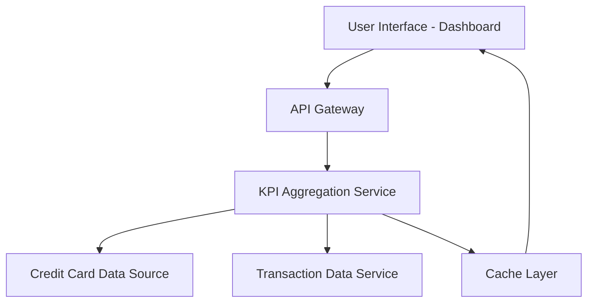

#### 1. High-Level Design

- **Summary**: This epic delivers a consolidated dashboard that aggregates and displays key performance indicators (KPIs) across all user credit cards, including monthly spending, total credit limit, available credit, and outstanding amounts. The interface is responsive and provides real-time visibility into the user's credit card portfolio health.

- **Component Flow**:

- **Integration Points**: 
  - **Upstream**: Credit card data source (for balance and limit information), Transaction data service (for monthly spend calculations)
  - **Downstream**: Dashboard UI (web, tablet, mobile clients)

- **Key Assumptions**: 
  - Real-time updates are achieved through periodic polling or event-driven refresh (frequency not specified, assumed to be configurable).
  - Credit card data source provides standardized API endpoints for balance, limit, and outstanding amount retrieval.

- **NFR Highlights**: Dashboard must be responsive across desktop, tablet, and mobile devices; KPI calculations must be accurate and update in real-time; System must support concurrent viewing by multiple users.

- **Data Flow**: User accesses the dashboard through a responsive UI. The API Gateway routes requests to the KPI Aggregation Service, which fetches credit card balance and limit data from the Credit Card Data Source and monthly spending data from the Transaction Data Service. The aggregation service calculates total credit limit, available credit, and outstanding amounts, caches the results for performance, and returns consolidated KPIs to the UI for display.

#### 2. Validation Report

- **Requirements Coverage**: The design covers all stated scope items: monthly spend display, total credit limit aggregation, available credit calculation, outstanding amount tracking, responsive dashboard layout, and multi-card consolidated view. The component architecture supports real-time KPI calculations, responsive UI delivery, and concurrent user access as specified in NFRs. Integration dependencies with credit card data source and transaction data service are addressed through dedicated service interfaces.