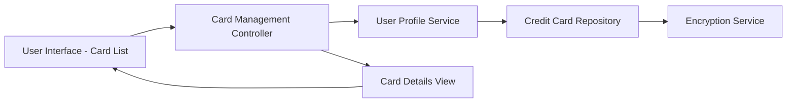

#### 1. High-Level Design

- **Summary:** This epic enables users to manage and monitor multiple credit cards within a consolidated interface. Users can view all their cards, access individual card details, navigate between cards, and track card-specific information such as credit limits, balances, and spending analysis. The system supports at least 10 credit cards per user with secure data handling.

- **Component Flow:**

- **Integration Points:**
  - **Upstream:** User profile service for retrieving user-card associations and ownership information
  - **Downstream:** Credit card data repository or API for fetching card details, limits, balances, and transaction history

- **Key Assumptions:** 
  - Card data is stored in a relational or document database with user-card associations managed via user profile service
  - Card selection state is maintained client-side during navigation; no server-side session state required

- **NFR Highlights:** System must support at least 10 credit cards per user; card data retrieval within 1 second; encryption required for data storage and transmission

#### 2. Validation Report

- **Requirements Coverage:** The design comprehensively addresses the epic's scope including multiple credit card display, card-wise information view, card selection and navigation, card details presentation, and card-wise spend analysis. The architecture includes dedicated components for card management, user profile integration, and security (encryption service). All NFRs are satisfied: support for 10+ cards, sub-1-second retrieval time through optimized queries, and encryption for secure data handling.