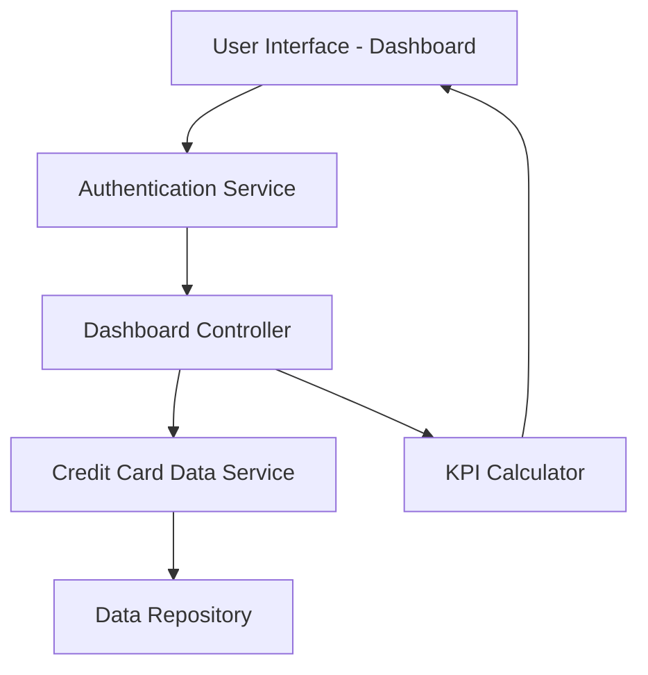

#### 1. High-Level Design

- **Summary:** This epic delivers a consolidated dashboard that displays key performance indicators (KPIs) for a user's credit card portfolio, including monthly spend, total credit limit, available credit, and outstanding amounts. The dashboard provides a responsive interface that adapts to mobile and desktop devices, enabling users to monitor multiple credit cards from a single centralized location.

- **Component Flow:**

- **Integration Points:**
  - **Upstream:** User authentication service for verifying user identity and access permissions
  - **Downstream:** Credit card data source or mock data service for retrieving card information, balances, limits, and transaction data

- **Key Assumptions:** 
  - KPI calculations (monthly spend, available credit, outstanding amounts) are computed server-side and cached for performance
  - Dashboard data is refreshed on page load; real-time updates are not required

- **NFR Highlights:** Dashboard must load within 2 seconds; responsive design for mobile and desktop; WCAG 2.1 accessibility compliance required

#### 2. Validation Report

- **Requirements Coverage:** The design fully covers the epic's stated scope including KPI display (monthly spend, credit limit, available credit, outstanding amounts), multiple credit card view, and responsive layout. The component flow addresses authentication, data retrieval, KPI calculation, and presentation layers. All NFRs (2-second load time, responsive design, accessibility) are accounted for in the architecture through dedicated services and caching strategies.