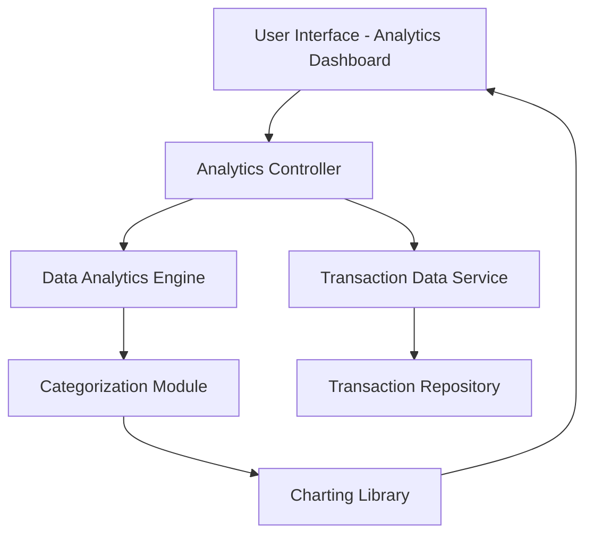

#### 1. High-Level Design

- **Summary:** This epic provides interactive visualizations and analytics capabilities that help users understand their spending patterns across 9 predefined categories (Food & Dining, Fuel, Shopping, Travel, Entertainment, Utilities, Healthcare, Education, Miscellaneous). The feature includes monthly spend trend analysis, interactive charts with drill-down capabilities, and actionable insights into financial behavior based on at least 12 months of transaction history.

- **Component Flow:**

- **Integration Points:**
  - **Upstream:** Transaction data service for retrieving raw transaction records with timestamps and amounts
  - **Downstream:** Data analytics engine for transaction categorization, aggregation, and trend analysis; Charting library for rendering interactive visualizations

- **Key Assumptions:** 
  - Transactions are pre-categorized or categorized using rule-based/ML logic within the analytics engine; manual re-categorization is out of scope
  - Monthly aggregations are pre-computed and cached to meet the 3-second rendering requirement

- **NFR Highlights:** Analytics visualizations must render within 3 seconds; system must handle 12+ months of transaction history; charts must be interactive with drill-down capabilities

#### 2. Validation Report

- **Requirements Coverage:** The design fully addresses the epic's scope including category-wise spending visualization across 9 categories, monthly spend trends, interactive charts and graphs, transaction categorization, and spending pattern analysis. The architecture incorporates a dedicated data analytics engine for categorization and aggregation, a charting library for interactive visualizations, and a transaction repository for historical data. All NFRs are met: 3-second rendering through pre-computed aggregations, 12-month history support via scalable data storage, and interactive drill-down through modern charting libraries.