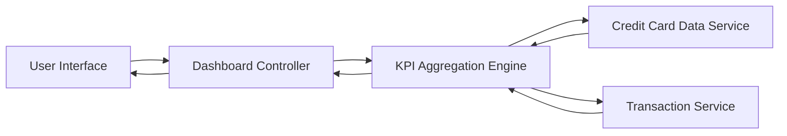

#### 1. High-Level Design

- **Summary:** This epic delivers a consolidated dashboard that displays key performance indicators (KPIs) for the user's credit card portfolio, including Monthly Spend, Total Credit Limit, Available Credit, and Outstanding Amount. The dashboard provides a unified, responsive interface for monitoring overall credit card financial health across all cards.

- **Component Flow:**

- **Integration Points:**
  - **Upstream:** Credit Card Data Service (for card balances and credit limits)
  - **Upstream:** Transaction Service (for monthly spend calculations)
  - **Downstream:** User Interface (responsive web/mobile client)

- **Key Assumptions:**
  - KPI data is refreshed at regular intervals (e.g., every 5 minutes or on-demand) to provide near-real-time updates.
  - Data aggregation logic assumes all active cards are included in portfolio-level KPI calculations.

- **NFR Highlights:** Dashboard must be responsive across desktop, tablet, and mobile devices; Page load time must be optimized for quick KPI rendering; UI must support real-time or near-real-time data refresh.

#### 2. Validation Report

- **Requirements Coverage:** The design fully covers the epic's stated scope by addressing all four KPIs (Monthly Spend, Total Credit Limit, Available Credit, Outstanding Amount), responsive layout requirements, and consolidated multi-card view. The component flow ensures data aggregation from the required services and efficient rendering on the user interface. NFRs related to responsiveness, performance, and data refresh are explicitly addressed in the architecture.