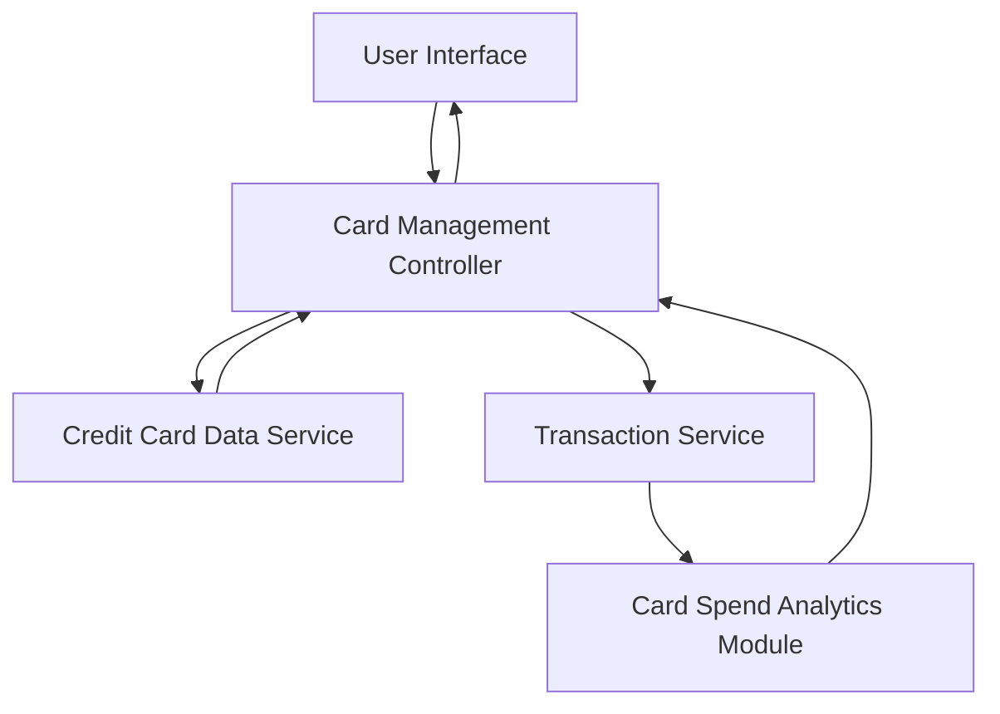

#### 1. High-Level Design

- **Summary:** This epic enables users to manage and monitor multiple credit cards from a single interface. Users can view all their cards, access card-specific details, and analyze spending patterns on a per-card basis to optimize card utilization, rewards, and benefits across their portfolio.

- **Component Flow:**

- **Integration Points:**
  - **Upstream:** Credit Card Data Service (for retrieving card information and details)
  - **Upstream:** Transaction Service (for card-specific transaction history and spending calculations)
  - **Downstream:** User Interface (for displaying card list, details, and spend analysis)

- **Key Assumptions:**
  - Card data is securely retrieved and cached for performance; card selection triggers on-demand spend analysis for the selected card.
  - System assumes each card has a unique identifier for filtering and tracking purposes.

- **NFR Highlights:** System must support management of multiple cards per user without performance degradation; Card data must be securely stored and displayed; Interface must handle varying numbers of cards gracefully.

#### 2. Validation Report

- **Requirements Coverage:** The design addresses all scope elements including multiple credit card display, card-wise spend analysis, individual card details view, and card selection/filtering capabilities. The architecture integrates with the required services (Credit Card Data Service and Transaction Service) and includes a dedicated Card Spend Analytics Module to support per-card spending analysis. Security and performance NFRs are incorporated into the design approach.