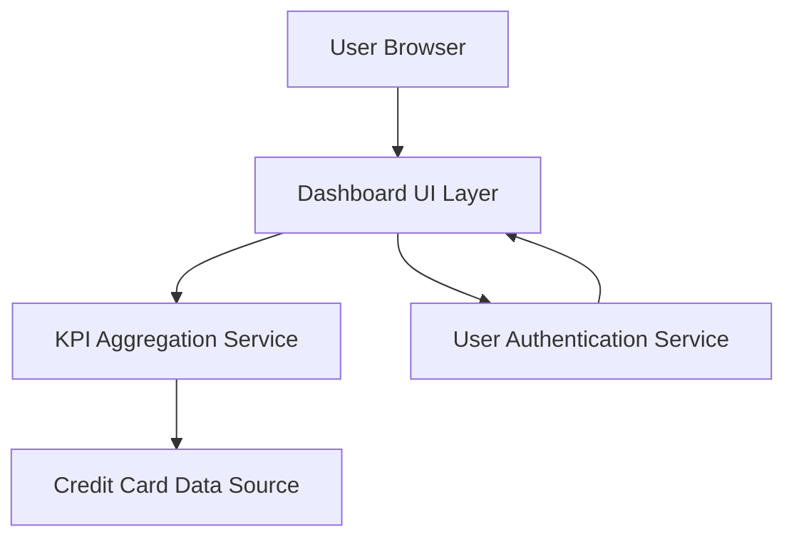

#### 1. High-Level Design

- **Summary**: This epic creates a centralized, responsive dashboard displaying key performance indicators for the credit card portfolio. Users can view critical financial metrics (monthly spend, total credit limit, available credit, outstanding amounts) across all cards in a consolidated interface. The dashboard provides real-time visibility into financial health and credit utilization, loading within 2 seconds and supporting concurrent users.

- **Component Flow**:

- **Integration Points**: 
  - **Upstream**: Credit card data source (for retrieving card details and balances), User authentication service (for secure access)
  - **Downstream**: Dashboard UI layer for consolidated KPI display

- **Key Assumptions**: 
  - Real-time or near real-time data refresh is achieved through periodic polling or push notifications from the credit card data source.
  - KPI calculations (total credit limit, available credit, outstanding amount) are performed by the KPI Aggregation Service based on raw card data.

- **NFR Highlights**: Dashboard must load within 2 seconds; system must support responsive design across desktop and mobile devices; real-time data refresh for KPI metrics; support for concurrent users viewing dashboard.

- **Data Flow**: User logs in via User Authentication Service → Dashboard UI Layer requests KPI data from KPI Aggregation Service → Service queries Credit Card Data Source for all user's card details and balances → Service calculates aggregated metrics (monthly spend, total credit limit, available credit, outstanding amounts) → Aggregated KPIs are returned to Dashboard UI → Dashboard displays consolidated view with real-time refresh capability → User views financial health at a glance.

#### 2. Validation Report

- **Requirements Coverage**: The design comprehensively covers dashboard KPI display, monthly spend tracking, total credit limit aggregation, available credit calculation, outstanding amount monitoring, responsive layout design, and multi-card consolidated view. All NFRs (2-second load time, responsive design, real-time refresh, concurrent user support) are addressed through the architecture and integration strategy.