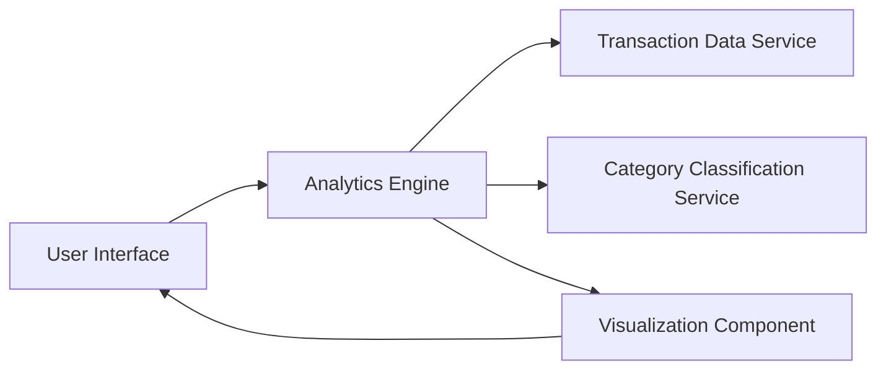

#### 1. High-Level Design

- **Summary**: This epic provides comprehensive spending analytics with interactive visualizations enabling users to understand spending patterns through charts and graphs. Users can analyze monthly trends and view category-wise breakdowns across nine predefined categories (Food & Dining, Fuel, Shopping, Travel, Entertainment, Utilities, Healthcare, Education, Miscellaneous). The system must support 12 months of historical data with responsive, drill-down capable visualizations.

- **Component Flow**:

- **Integration Points**: 
  - **Upstream**: Transaction data service (for retrieving spending details), Category classification service (for automated expense categorization)
  - **Downstream**: Analytics engine (for processing and categorizing transactions), Visualization component (for rendering charts)

- **Key Assumptions**: 
  - Transactions are pre-categorized or can be auto-categorized into the nine predefined categories with acceptable accuracy.
  - Historical data for at least 12 months is available and accessible via the transaction data service.

- **NFR Highlights**: Analytics visualizations must render within 3 seconds; support for minimum 12 months of historical data; interactive charts must be responsive and support drill-down capabilities.

- **Data Flow**: User accesses analytics dashboard → Analytics Engine requests transaction data from Transaction Data Service → Category Classification Service categorizes transactions into nine categories → Analytics Engine aggregates data by month and category → Processed data is sent to Visualization Component → Interactive charts and graphs (monthly trends, category breakdowns) are rendered in UI → User interacts with visualizations for drill-down insights.

#### 2. Validation Report

- **Requirements Coverage**: The design addresses all scope elements including monthly spend trend analysis, category-wise spending visualization, interactive charts and graphs, spending pattern identification, nine-category breakdown, and historical data analysis. All NFRs (3-second render time, 12 months history, responsive drill-down) are incorporated into the architecture.