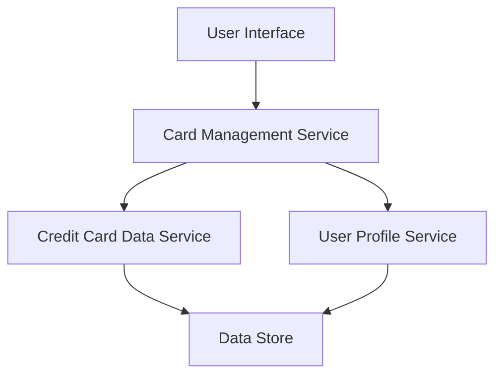

#### 1. High-Level Design

- **Summary**: This epic delivers a unified platform for users to manage and monitor multiple credit cards simultaneously. Users can view individual card details, track card-specific spending, analyze portfolio performance, and compare cards within a single interface. The system must support at least 10 cards per user with secure data handling and fast retrieval.

- **Component Flow**:

- **Integration Points**: 
  - **Upstream**: Credit card data service (for retrieving card information), User profile service (for associating cards with user accounts)
  - **Downstream**: User interface layer for display

- **Key Assumptions**: 
  - Card data is provided in a standardized format (JSON/XML) by the credit card data service.
  - Card numbers are masked at the data service layer before being sent to the UI.

- **NFR Highlights**: System must support minimum 10 credit cards per user; card data retrieval latency must be under 500ms; secure storage and display of card information with masked card numbers.

- **Data Flow**: User requests card portfolio view → Card Management Service queries Credit Card Data Service and User Profile Service → Services retrieve card details and user associations from Data Store → Card information (with masked numbers) is aggregated and returned to UI → User views consolidated multi-card dashboard with individual card details and comparison capabilities.

#### 2. Validation Report

- **Requirements Coverage**: The design fully covers the epic's scope including multiple credit card display, card-wise spend analysis, individual card details view, card comparison capabilities, and card portfolio overview. All NFRs (10 cards per user, <500ms latency, secure masked display) are addressed through the component architecture and integration points.