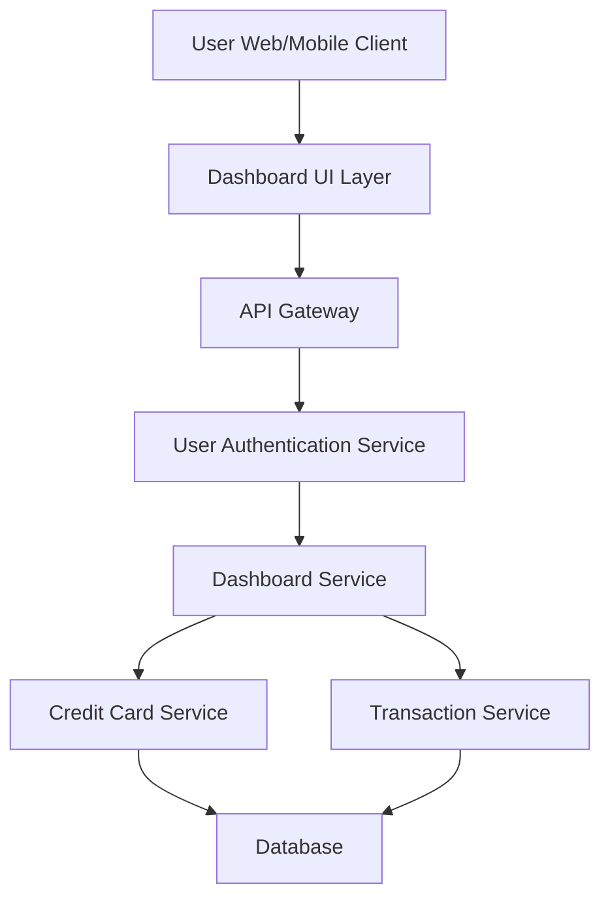

#### 1. High-Level Design

- **Summary:** This epic delivers a centralized, responsive dashboard that consolidates all user credit cards and displays key performance indicators (KPIs) including monthly spend, total credit limit, available credit, and outstanding amount. The dashboard provides real-time insights into credit utilization and spending patterns, enabling users to monitor their financial health across multiple cards from a single interface.

- **Component Flow:**

- **Integration Points:**
  - **Upstream:** User Authentication Service for secure user access and session management
  - **Downstream:** Credit Card Service for retrieving card details and credit limits; Transaction Service for calculating monthly spend and outstanding amounts
  - **Data Store:** Database for persisting card and transaction data

- **Key Assumptions:**
  - KPI calculations (monthly spend, available credit, outstanding amount) are computed server-side in real-time upon dashboard load
  - Data refresh mechanism uses polling or push notifications to update dashboard metrics without full page reload

- **NFR Highlights:** Dashboard must load within 2 seconds; support responsive design across desktop, tablet, and mobile devices; handle real-time data refresh for up to 10 credit cards per user

#### 2. Validation Report

- **Requirements Coverage:** The design fully covers the epic's stated scope including dashboard interface, KPI calculation and display (monthly spend, total credit limit, available credit, outstanding amount), multi-card consolidated view, and responsive layout. All specified NFRs (2-second load time, responsive design, 10-card support) are addressed through appropriate service architecture and UI layer design. Integration dependencies with Credit Card Service, Transaction Service, and User Authentication Service are incorporated.