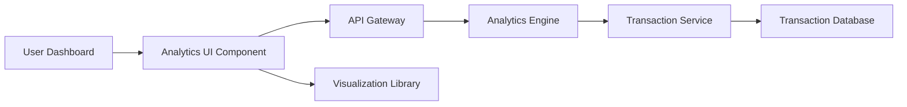

#### 1. High-Level Design

- **Summary:** This epic provides interactive visualizations and analytics to help users understand spending patterns through category-wise analysis and monthly spend trends. Users can view detailed expense breakdowns across predefined categories (Food & Dining, Fuel, Shopping, Travel, Entertainment, Utilities, Healthcare, Education, Miscellaneous) and historical spending data, enabling data-driven financial decisions.

- **Component Flow:**

- **Integration Points:**
  - **Upstream:** Transaction Service for transaction data and category classification
  - **Downstream:** Analytics Engine for data aggregation, computation, and trend analysis; Visualization Library (e.g., Chart.js, D3.js) for rendering interactive charts
  - **Data Store:** Transaction Database containing historical transaction records with category tags

- **Key Assumptions:**
  - Transactions are pre-categorized by the Transaction Service using rule-based or ML classification; category assignment is not performed in the analytics layer
  - Monthly spend trends are computed from aggregated historical data stored for at least 12 months

- **NFR Highlights:** Analytics visualizations must render within 3 seconds; system must support historical data for minimum 12 months; charts must be interactive and responsive across all device types; category calculations accurate to 2 decimal places

#### 2. Validation Report

- **Requirements Coverage:** The design comprehensively covers the epic's scope including category-wise spending visualization, monthly spend trend charts, interactive analytics dashboard, spending breakdown by predefined categories, historical spending data display, and data filtering/drill-down capabilities. All NFRs (3-second render time, 12-month historical data, responsive interactive charts, 2-decimal accuracy) are addressed through the Analytics Engine and Visualization Library integration. Dependencies on Transaction Service, Analytics Engine, and Visualization Library are properly incorporated in the architecture.