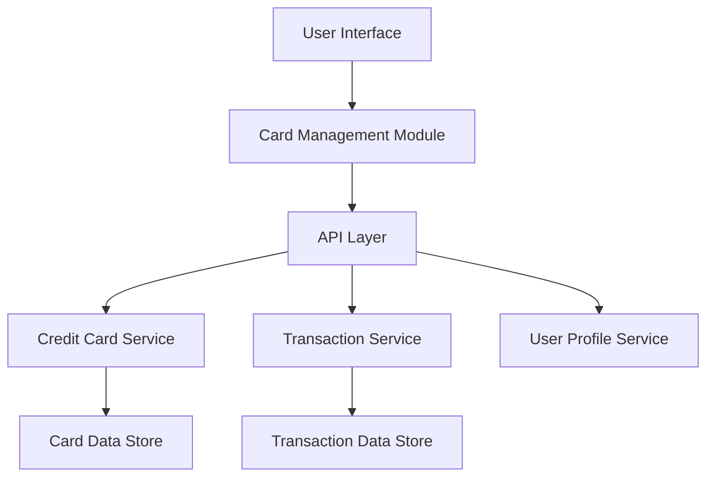

#### 1. High-Level Design

- **Summary:** This epic enables users to manage and track multiple credit cards within the application, providing comprehensive card-level details including card number, issuer, credit limit, current balance, and status. It delivers card-wise spend analysis to help users understand spending patterns across individual cards, supporting efficient multi-card portfolio management.

- **Component Flow:**

- **Integration Points:**
  - **Upstream:** User Profile Service for associating credit cards with user accounts
  - **Downstream:** Credit Card Service for retrieving card information (card number, issuer, limit, status); Transaction Service for card-specific spending data and analysis
  - **Data Store:** Card Data Store and Transaction Data Store for persistent storage

- **Key Assumptions:**
  - Card numbers are stored securely (masked/tokenized) and displayed with partial masking (e.g., last 4 digits visible)
  - Card-wise spend analysis aggregates transactions on-demand or via pre-computed daily summaries

- **NFR Highlights:** System must support minimum 10 credit cards per user account; card data retrieval must complete within 1 second; card information displayed in responsive grid layout

#### 2. Validation Report

- **Requirements Coverage:** The design addresses all scope elements including multiple credit card display, card details view, card-wise spend analysis, individual card credit limit tracking, per-card balance display, and card status monitoring. NFRs for 10-card support, 1-second retrieval time, and responsive grid layout are incorporated through service-oriented architecture and efficient data retrieval patterns. All integration dependencies (Credit Card Service, Transaction Service, User Profile Service) are included in the component flow.