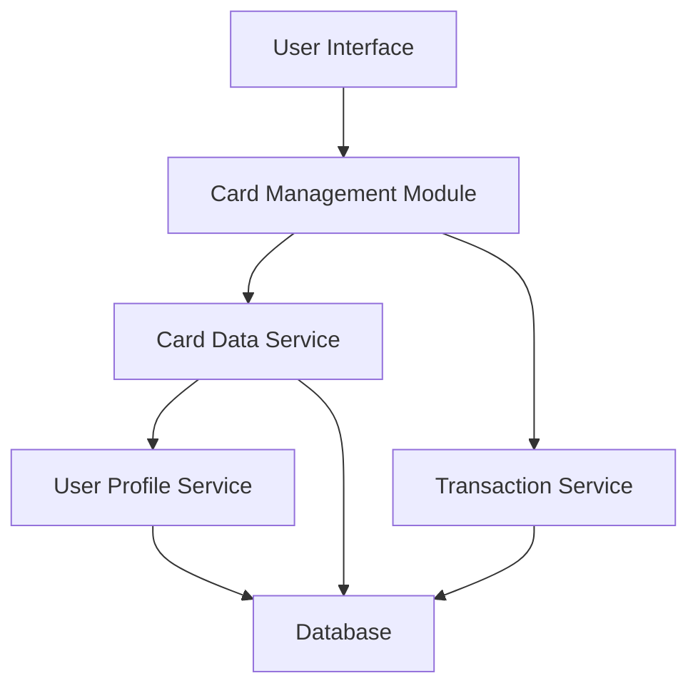

#### 1. High-Level Design

- **Summary:** This epic enables users to manage and monitor multiple credit cards within a single interface. Users can view individual card details, track card-specific spending, analyze expenditure patterns per card, and compare performance across different cards. The feature provides card-level insights to optimize credit card usage strategy across the portfolio.

- **Component Flow:**

- **Integration Points:**
  - Credit card data service or API for retrieving card details and metadata
  - User profile service for card ownership validation and user-card association
  - Transaction data service for card-level transaction history and spend analysis

- **Key Assumptions:**
  - Card ownership is validated at the user profile service level. Card-wise spend calculations aggregate transaction data by card identifier with monthly rollup performed server-side.

- **NFR Highlights:** System must support minimum 10 credit cards per user; card data retrieval must complete within 1 second; ensure data isolation and security for each card.

#### 2. Validation Report

- **Requirements Coverage:** The design addresses all scope elements including multiple credit card display, card-wise spend analysis, individual card detail views, card comparison capabilities, card-level transaction visibility, and monthly spend trends per card. The architecture supports the NFR requirement of 10+ cards per user and 1-second retrieval through efficient data service design. Integration with user profile service ensures proper card ownership validation, and data isolation is enforced at the service layer.