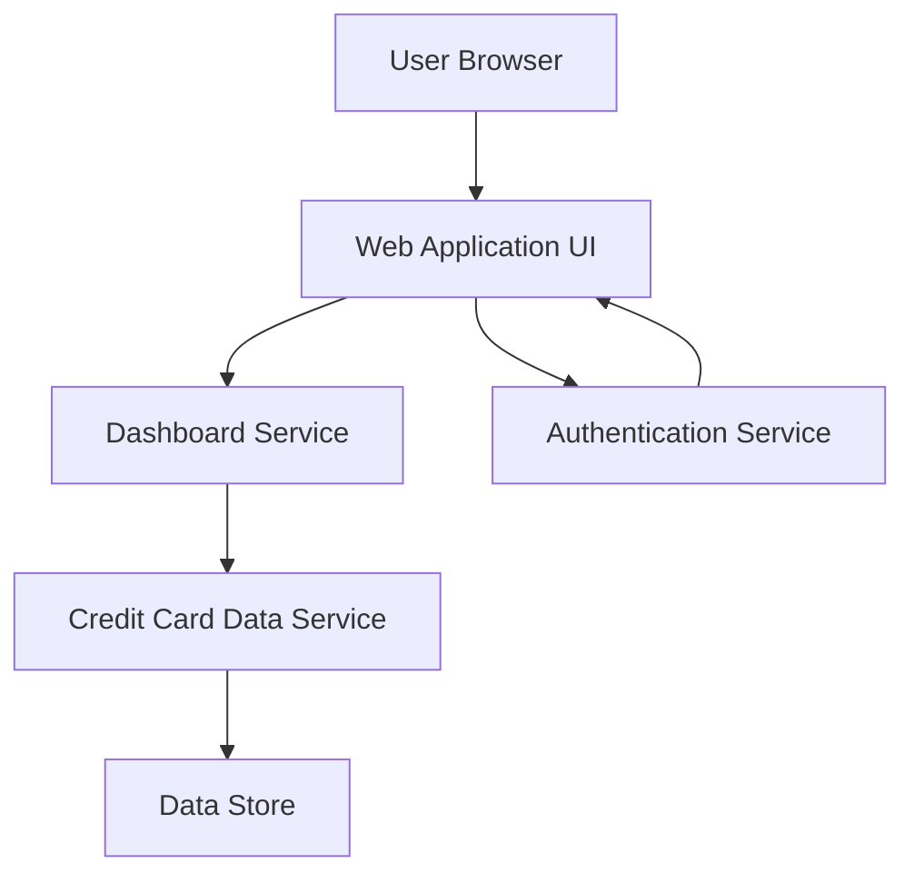

#### 1. High-Level Design

- **Summary:** This epic delivers a consolidated dashboard that displays key performance indicators (KPIs) for the user's credit card portfolio, including monthly spend, total credit limit, available credit, and outstanding amounts. The dashboard provides real-time visibility into financial health through a modern, responsive interface accessible on both mobile and desktop devices.

- **Component Flow:**

- **Integration Points:**
  - Credit card data source or mock data service for retrieving card and transaction data
  - User authentication service for secure access control
  - Real-time data refresh mechanism for KPI updates

- **Key Assumptions:**
  - KPI calculations (available credit, utilization) are performed server-side and cached appropriately. Data refresh frequency is configurable but defaults to near real-time for dashboard views.

- **NFR Highlights:** Dashboard must load within 2 seconds; support responsive design for mobile and desktop; handle real-time data refresh for KPI metrics.

#### 2. Validation Report

- **Requirements Coverage:** The design fully covers the epic's stated scope including dashboard KPI display, monthly spend tracking, credit limit aggregation, available credit calculation, outstanding amount visibility, responsive UI layout, and multi-card consolidated view. The architecture supports the 2-second load time requirement through efficient service layer design and assumes appropriate caching strategies. Integration with authentication and data services addresses the stated dependencies.