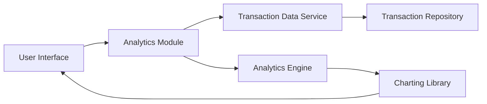

#### 1. High-Level Design

- **Summary:** This epic provides interactive visualizations and analytics capabilities for users to understand spending patterns through category-wise analysis. Users can explore transactions across predefined categories (Food & Dining, Fuel, Shopping, Travel, Entertainment, Utilities, Healthcare, Education, Miscellaneous) with visual representations that help identify high-expenditure areas and savings opportunities.

- **Component Flow:**

- **Integration Points:**
  - Transaction data service or repository for retrieving categorized transaction data
  - Analytics engine for data aggregation, filtering, and spending pattern computation
  - Charting library for rendering interactive visualizations and graphs

- **Key Assumptions:**
  - Transactions are pre-categorized at ingestion or categorization is performed by a separate service. Historical data aggregation is pre-computed for common time ranges to meet the 1.5-second rendering requirement.

- **NFR Highlights:** Analytics visualizations must render within 1.5 seconds; support interactive filtering and drill-down capabilities; handle minimum 1000 transactions per user efficiently.

#### 2. Validation Report

- **Requirements Coverage:** The design comprehensively covers the epic's scope including category-wise spending visualization, interactive charts and graphs, transaction listing and filtering, spending pattern analysis, multi-category breakdown, historical spending trends, and category-based insights. The architecture supports the NFR of 1.5-second rendering through efficient analytics engine design and assumes pre-aggregated data for common queries. The design handles 1000+ transactions efficiently through proper indexing and pagination strategies in the transaction repository.