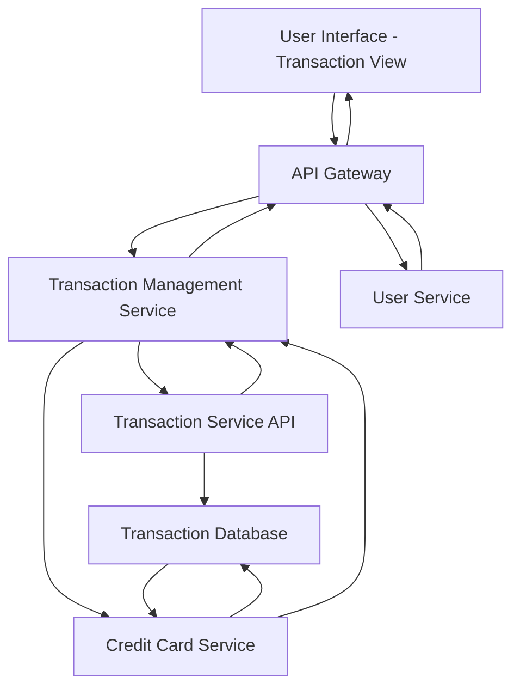

#### 1. High-Level Design

- **Summary:** This epic enables users to view, monitor, and manage credit card transactions across all their cards through a centralized interface. Users can access detailed transaction histories, view individual transaction details, search and filter transactions, and track spending activities in real-time with support for up to 12 months of transaction history.

- **Component Flow:**

- **Integration Points:**
  - **Upstream:** User Service (for authentication and authorization), Credit Card Service (for mapping transactions to specific cards)
  - **Downstream:** Transaction Service API (for fetching transaction data with search, filter, and pagination capabilities)

- **Key Assumptions:**
  - Transaction data is stored with encrypted fields for sensitive information (card numbers, amounts).
  - Pagination is implemented server-side with configurable page size (e.g., 20-50 transactions per page).

- **NFR Highlights:** Transaction list must support pagination for large datasets; search and filter operations must complete within 500ms; system must handle transaction history for up to 12 months; data must be encrypted at rest and in transit.

- **Data Flow:** User authenticates via User Service → User requests transaction list (with optional filters: date range, card, amount range) → Transaction Management Service receives request via API Gateway → Service queries Transaction Service API with pagination parameters and filters → Transaction Service API retrieves encrypted transaction data from database → Credit Card Service maps transactions to user's specific cards → Decrypted transaction data is aggregated and paginated → Transaction Management Service returns paginated transaction list to UI → User can view transaction details, search, filter, or navigate pages → Real-time updates push new transactions to UI as they occur.

#### 2. Validation Report

- **Requirements Coverage:** The design comprehensively covers all scope elements including transaction listing and display, transaction detail view, multi-card transaction aggregation, transaction search and filtering, transaction history access, and real-time transaction updates. All NFRs are addressed: pagination for large datasets, 500ms search/filter performance, 12-month history support, and encryption at rest and in transit. Integration dependencies with Transaction Service API, Credit Card Service, and User Service are explicitly mapped in the component flow.