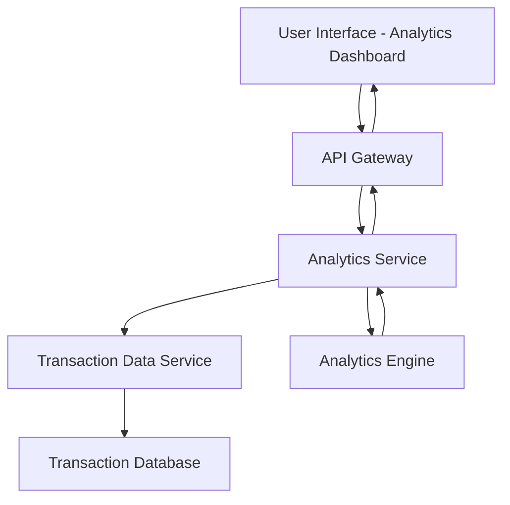

#### 1. High-Level Design

- **Summary:** This epic provides interactive visualizations and analytics capabilities that enable users to understand spending patterns across predefined categories (Food & Dining, Fuel, Shopping, Travel, Entertainment, Utilities, Healthcare, Education, Miscellaneous). Users can analyze category-wise spending, view monthly trends, and perform card-wise spend analysis through responsive, interactive charts and graphs.

- **Component Flow:**

- **Integration Points:**
  - **Upstream:** Transaction Data Service (for retrieving categorized transaction history)
  - **Downstream:** Analytics Engine (for processing, aggregating, and computing spending data by category, time period, and card)

- **Key Assumptions:**
  - Transactions are pre-categorized by the Transaction Data Service or a separate categorization engine.
  - Analytics visualizations use client-side charting libraries (e.g., Chart.js, D3.js) with data aggregated server-side.

- **NFR Highlights:** Analytics visualizations must render within 1 second; support filtering and drill-down capabilities; charts must be responsive and interactive across all device types.

- **Data Flow:** User selects analytics view (category, time period, card filter) → Analytics Service receives request via API Gateway → Analytics Service queries Transaction Data Service for categorized transaction history → Transaction Data Service retrieves raw transaction data from database → Analytics Engine processes and aggregates data by category, month, and card → Aggregated spending data is returned to Analytics Service → Analytics Service formats data for visualization → Data is sent to UI for rendering interactive charts and graphs → User interacts with visualizations (filtering, drill-down) triggering additional data requests.

#### 2. Validation Report

- **Requirements Coverage:** The design addresses all scope elements including category-wise spending visualization, interactive charts and graphs, monthly spend trend analysis, card-wise spend analysis, multi-category spending breakdown, and spending pattern identification. NFRs for 1-second rendering, filtering/drill-down capabilities, and responsive interactive charts are supported through the architecture separating Analytics Service and Analytics Engine. Integration dependencies with Transaction Data Service and Analytics Engine are clearly defined.