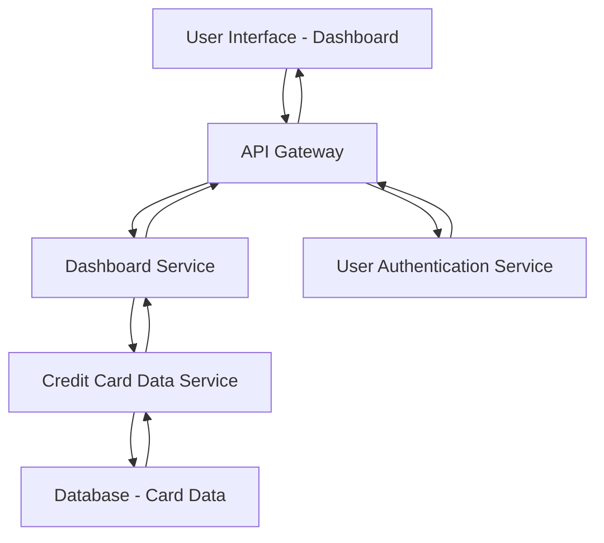

#### 1. High-Level Design

- **Summary:** This epic delivers a consolidated dashboard that aggregates and displays key performance indicators (KPIs) for a user's credit card portfolio, including monthly spend, total credit limit, available credit, and outstanding amounts. The dashboard provides real-time visibility across multiple credit cards through a responsive interface accessible on desktop, tablet, and mobile devices.

- **Component Flow:**

- **Integration Points:**
  - **Upstream:** User Authentication Service (for secure user session validation and authorization)
  - **Downstream:** Credit Card Data Service (for retrieving card details, balances, credit limits, and outstanding amounts)

- **Key Assumptions:**
  - KPI data is retrieved via RESTful API calls with JSON response format.
  - Real-time refresh occurs via polling mechanism (e.g., every 30-60 seconds) or WebSocket connection for live updates.

- **NFR Highlights:** Dashboard must be responsive across desktop, tablet, and mobile devices; page load time under 2 seconds; support real-time data refresh for KPI metrics.

- **Data Flow:** User authenticates via User Authentication Service → Dashboard Service requests aggregated card data from Credit Card Data Service → Credit Card Data Service queries database for user's card details, balances, limits, and outstanding amounts → Data is aggregated and returned to Dashboard Service → Dashboard Service formats KPIs (monthly spend, total credit limit, available credit, outstanding amounts) → Data is sent to UI layer for rendering in responsive layout → Real-time updates refresh KPIs periodically.

#### 2. Validation Report

- **Requirements Coverage:** The design fully covers the epic's stated scope including dashboard KPI display, monthly spend tracking, credit limit aggregation, available credit calculation, outstanding amount tracking, multiple credit card view, and responsive layout. All NFRs (responsiveness, 2-second load time, real-time refresh) are addressed through the architecture. Integration dependencies with Credit Card Data Service and User Authentication Service are explicitly mapped in the component flow.