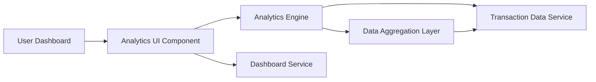

#### 1. High-Level Design

- **Summary:** This epic delivers analytics capabilities that transform transaction data into actionable insights through interactive visualizations. It provides category-wise spending breakdowns across 9 categories (Food & Dining, Fuel, Shopping, Travel, Entertainment, Utilities, Healthcare, Education, Miscellaneous), monthly spend trends, and card-wise spend analysis.

- **Component Flow:**

- **Integration Points:**
  - **Upstream:** Transaction Data Service (for spending data aggregation)
  - **Upstream:** Analytics Engine (for data processing and categorization)
  - **Upstream:** Dashboard Service (for KPI integration)

- **Key Assumptions:**
  - Transaction categorization is automated using predefined rules or merchant category codes (MCC); manual re-categorization capability assumed but not specified.
  - Analytics data is pre-aggregated and cached to meet the 3-second rendering requirement for up to 10,000 transactions.

- **NFR Highlights:** Analytics visualizations must render within 3 seconds; process and aggregate up to 10,000 transactions; charts must be interactive and responsive across devices.

#### 2. Validation Report

- **Requirements Coverage:** The design comprehensively covers all scope elements including category-wise visualization across 9 categories, monthly trend analysis, card-wise analysis, interactive charts, and spending pattern identification. The architecture supports the 3-second rendering NFR through data pre-aggregation, caching strategies, and efficient chart rendering libraries. The 10,000 transaction processing requirement is addressed through scalable data aggregation pipelines and optimized analytics algorithms. Interactive and responsive charts are enabled through modern JavaScript visualization libraries (e.g., Chart.js, D3.js) with mobile-first design. Integration with Transaction Data Service, Analytics Engine, and Dashboard Service creates a cohesive analytics ecosystem that transforms raw data into meaningful insights.