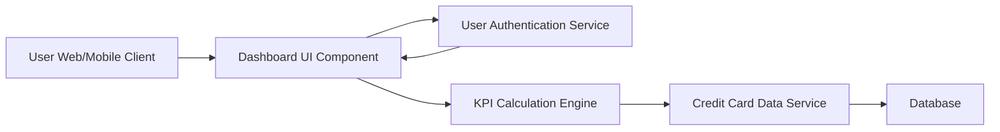

#### 1. High-Level Design

- **Summary:** This epic delivers a comprehensive credit card portfolio dashboard that consolidates all user credit cards and displays real-time KPIs (Monthly Spend, Total Credit Limit, Available Credit, Outstanding Amount). The dashboard provides at-a-glance financial health insights with a modern, responsive interface accessible across devices.

- **Component Flow:**

- **Integration Points:**
  - **Upstream:** User Authentication Service (for secure access control)
  - **Downstream:** Credit Card Data Service (for retrieving card information and balances)

- **Key Assumptions:** 
  - KPI metrics are calculated server-side and cached for performance; data refresh occurs at configurable intervals (assumed every 30-60 seconds for "real-time").
  - Credit card data format follows a standardized schema provided by the Credit Card Data Service API.

- **NFR Highlights:** Dashboard must load within 2 seconds; responsive design for mobile and desktop; real-time data refresh capability for KPI metrics.

#### 2. Validation Report

- **Requirements Coverage:** The design fully covers the epic's stated scope including all four KPI displays (Monthly Spend, Total Credit Limit, Available Credit, Outstanding Amount), multi-card consolidated view, and responsive layout. The architecture supports the NFRs for 2-second load time through caching and optimized data retrieval, responsive design through modern UI frameworks, and real-time refresh through periodic data synchronization. Integration dependencies are addressed through defined service contracts with Credit Card Data Service and User Authentication Service.