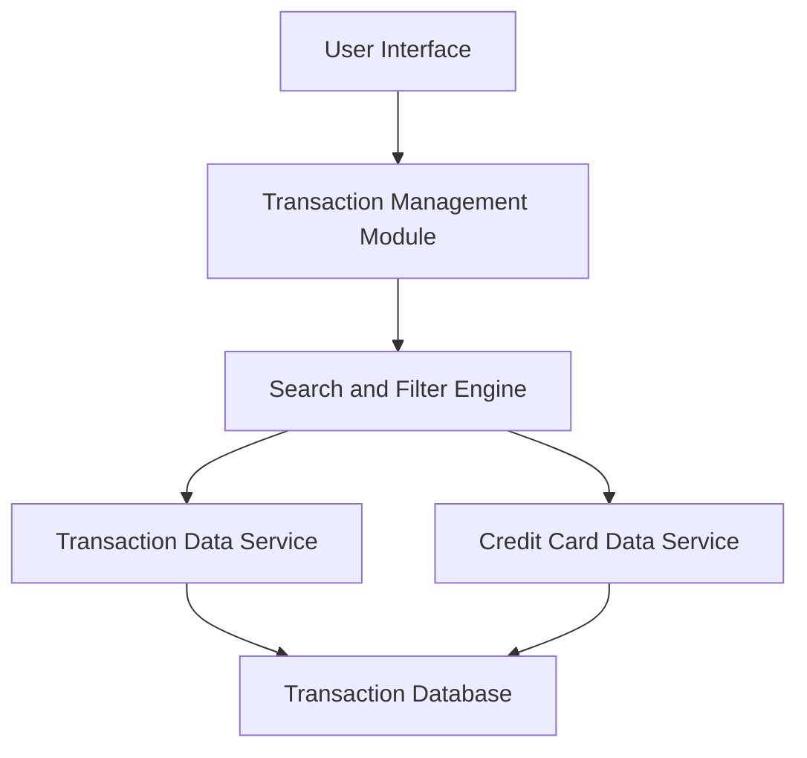

#### 1. High-Level Design

- **Summary:** This epic enables users to view, search, and manage credit card transactions across all their cards from a unified interface. It provides detailed transaction histories with filtering capabilities, supporting transparency, expense tracking, and fraud detection for up to 12 months of transaction data.

- **Component Flow:**

- **Integration Points:**
  - **Upstream:** Transaction Data Service (for retrieving transaction records)
  - **Upstream:** Credit Card Data Service (for card-specific transaction filtering)

- **Key Assumptions:**
  - Transactions are indexed by date, card ID, and category for sub-second query performance.
  - Transaction data is synchronized from external sources in near real-time or batch mode (frequency not specified in epic).

- **NFR Highlights:** Transaction queries must return results within 1 second; handle 12 months of transaction history; support concurrent access by multiple users.

#### 2. Validation Report

- **Requirements Coverage:** The design addresses all scope elements including transaction listing, multi-card view, search/filtering, detail view, and history tracking. The architecture supports the 1-second query response NFR through database indexing and optimized query patterns. The 12-month history requirement is handled through data retention policies and efficient storage. Concurrent user access is supported through stateless service design and database connection pooling. Integration with Transaction Data Service and Credit Card Data Service enables comprehensive transaction management across all user cards.