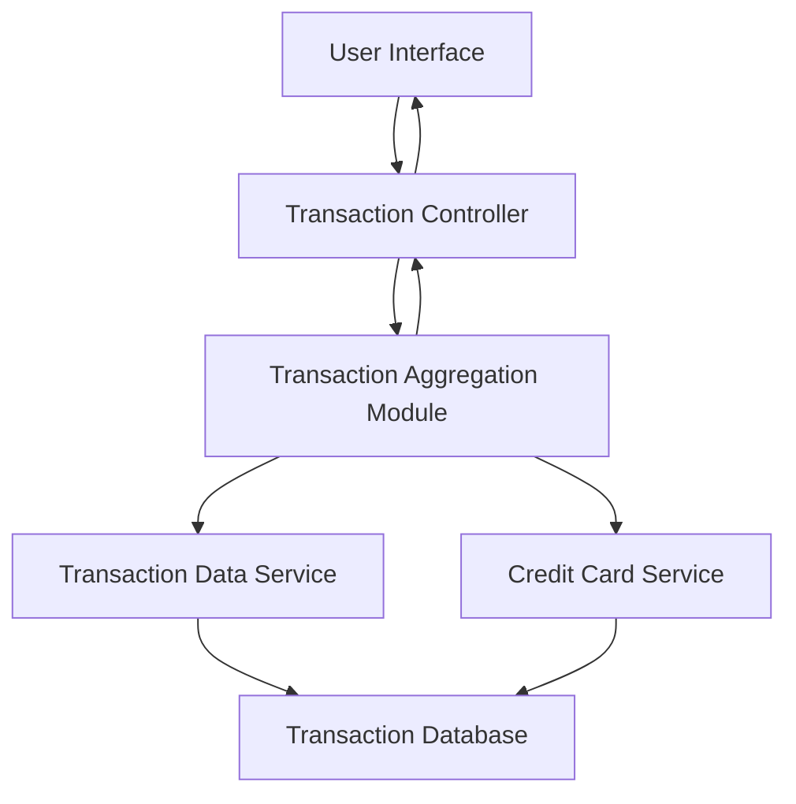

#### 1. High-Level Design

- **Summary:** This epic enables users to view and monitor all credit card transactions across their multiple cards. Users gain access to detailed transaction histories, providing complete transparency into spending activities. The transaction management capability supports tracking purchases, identifying unauthorized transactions, and maintaining accurate financial records for budgeting and reconciliation purposes.

- **Component Flow:**

- **Integration Points:**
  - **Upstream:** Transaction Data Service (for retrieving historical and current transactions)
  - **Downstream:** Credit Card Service (for mapping transactions to specific cards and card details)

- **Key Assumptions:**
  - Transaction data is stored with sufficient detail (date, amount, merchant, category, card identifier) for display and filtering.
  - Transaction history retrieval supports pagination or lazy loading for handling large volumes efficiently.

- **NFR Highlights:** System must handle large volumes of transaction data efficiently; Transaction data must be displayed with high accuracy; Interface must be responsive across all device types.

- **Data Flow:** User requests transaction view → Transaction Controller invokes Transaction Aggregation Module → Module queries Transaction Data Service for transaction records → Credit Card Service provides card mapping and details → Aggregation Module consolidates transactions across multiple cards → Sorted and filtered transaction list returned to Transaction Controller → User Interface displays transaction listing with details (date, merchant, amount, card, category) → User can drill down into individual transaction details.

#### 2. Validation Report

- **Requirements Coverage:** The design fully addresses the epic's requirements by providing transaction listing, transaction history view, multi-card transaction aggregation, transaction details display, and responsive transaction interface. The architecture efficiently handles large volumes of transaction data through the Transaction Aggregation Module and supports accurate data display through direct integration with Transaction Data Service and Credit Card Service. All NFRs regarding efficient data handling, high accuracy, and responsive interface are addressed through the component architecture and data flow design. The solution provides the transparency and control needed for users to track spending, detect anomalies, and maintain accurate financial records.