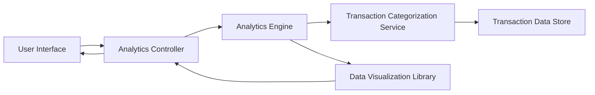

#### 1. High-Level Design

- **Summary:** This epic provides users with interactive analytics and visualizations to understand spending patterns across multiple dimensions. Users can analyze spending through monthly trends, card-wise comparisons, and category-wise breakdowns across nine predefined categories (Food & Dining, Fuel, Shopping, Travel, Entertainment, Utilities, Healthcare, Education, Miscellaneous). The analytics enable data-driven financial decisions and help users optimize credit card usage based on their spending behavior.

- **Component Flow:**

- **Integration Points:**
  - **Upstream:** Transaction Categorization Service (for assigning spending categories to transactions)
  - **Downstream:** Analytics Engine (for data processing and aggregation), Data Visualization Library (for rendering interactive charts and graphs)

- **Key Assumptions:**
  - Transaction categorization is automated or pre-assigned; categories follow the nine predefined types specified.
  - Analytics data is aggregated on-demand or pre-computed periodically for performance optimization.

- **NFR Highlights:** Visualizations must load within acceptable performance thresholds; Analytics must support interactive user engagement; Charts must be responsive and accessible across devices; Data aggregation must be accurate and consistent.

- **Data Flow:** User requests analytics view → Analytics Controller invokes Analytics Engine → Engine retrieves transaction data from Transaction Data Store → Transaction Categorization Service assigns or confirms categories for transactions → Analytics Engine aggregates data by month, card, and category → Processed data passed to Data Visualization Library → Interactive charts/graphs rendered and returned to User Interface → User interacts with visualizations (drill-down, filter, compare).

#### 2. Validation Report

- **Requirements Coverage:** The design comprehensively covers all stated requirements including monthly spend trends, card-wise spend analysis, and category-wise spending analytics across all nine specified categories. The architecture supports interactive visualizations through the Data Visualization Library and ensures data accuracy through the Analytics Engine's aggregation logic. The Transaction Categorization Service integration ensures proper assignment of spending categories. All NFRs regarding performance thresholds, interactive engagement, responsive design, and data accuracy are addressed through the component design and data flow architecture.