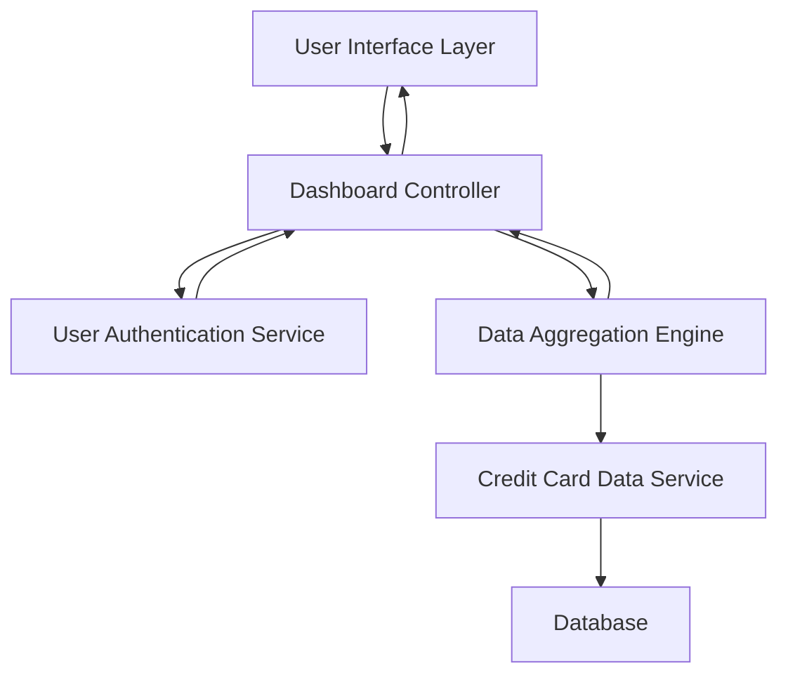

#### 1. High-Level Design

- **Summary:** This epic delivers a consolidated dashboard providing users with a unified view of their credit card portfolio. The dashboard displays key performance indicators including monthly spending, total credit limits, available credit, and outstanding amounts across all cards. It serves as the primary entry point for users to monitor their overall credit card financial health and make informed spending decisions.

- **Component Flow:**

- **Integration Points:**
  - **Upstream:** User Authentication Service (for secure access and user identity verification)
  - **Downstream:** Credit Card Data Service (for retrieving card details, balances, limits, and spending data)

- **Key Assumptions:**
  - Credit card data is available in near real-time or with acceptable latency for dashboard refresh.
  - User owns multiple credit cards, and data aggregation logic handles cards from potentially different sources/providers.

- **NFR Highlights:** System must support responsive layouts across desktop, tablet, and mobile devices; Dashboard load time must be optimized for quick access; Data accuracy and real-time synchronization required.

- **Data Flow:** User authenticates via User Authentication Service → Dashboard Controller requests user's credit card data → Data Aggregation Engine fetches card details from Credit Card Data Service → Engine calculates KPIs (monthly spend, total credit limit, available credit, outstanding amounts) → Aggregated data returned to Dashboard Controller → UI Layer renders consolidated dashboard with all KPIs and multi-card view.

#### 2. Validation Report

- **Requirements Coverage:** The design fully addresses the epic's stated scope by incorporating all required KPI displays (monthly spend, total credit limit, available credit, outstanding amounts), multi-card view capability, and responsive layout design. The architecture supports real-time data synchronization through the Credit Card Data Service and ensures secure access via User Authentication Service. All NFRs regarding responsive design, optimized load times, and data accuracy are addressed through the component architecture and data aggregation approach.