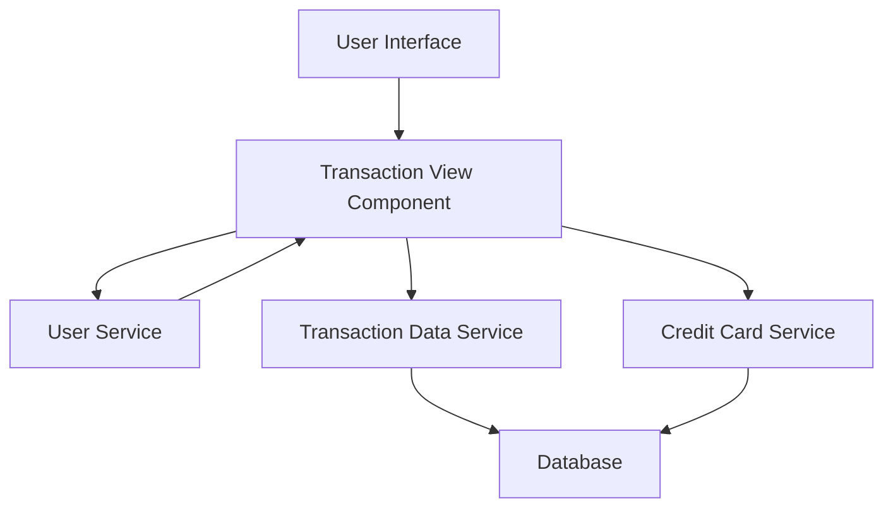

#### 1. High-Level Design

- **Summary:** This epic enables users to view and manage credit card transactions from a unified interface across all their cards. Core requirements include displaying detailed transaction history, providing search and filter capabilities, and aggregating transactions from multiple cards. The solution delivers complete transparency into spending activities with responsive design.

- **Component Flow:**

- **Integration Points:**
  - **Upstream:** User Service (for authentication and authorization)
  - **Downstream:** Transaction Data Service (for retrieving transaction records), Credit Card Service (for card-transaction mapping and card metadata)

- **Key Assumptions:**
  - Transaction Data Service supports efficient querying with pagination and filtering capabilities to meet the 500ms response time requirement.
  - Transaction data format is standardized across all credit cards with consistent field mappings for search and filter operations.

- **NFR Highlights:** System must handle up to 10,000 transactions per user; Transaction query response time must be under 500ms; Support pagination for large transaction datasets.

#### 2. Validation Report

- **Requirements Coverage:** The design addresses all scope elements including transaction list view, transaction details display, multi-card transaction aggregation, search and filtering, transaction history access, and responsive interface. Integration dependencies with Transaction Data Service, Credit Card Service, and User Service are incorporated. All NFRs (10,000 transactions capacity, 500ms response time, pagination support) are reflected in the architecture design.