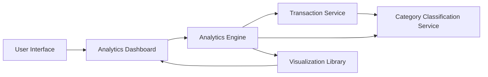

#### 1. High-Level Design

- **Summary:** This epic delivers interactive data visualizations and analytics to help users understand spending patterns through category-wise analysis and monthly trends. Core requirements include visualizing spending across nine predefined categories (Food & Dining, Fuel, Shopping, Travel, Entertainment, Utilities, Healthcare, Education, Miscellaneous), card-wise spend comparison, and monthly trend analysis with interactive charts.

- **Component Flow:**

- **Integration Points:**
  - **Upstream:** Transaction Service (for raw spending data), Category Classification Service (for transaction categorization into nine predefined categories)
  - **Downstream:** Analytics Engine (for data aggregation, calculations, and trend analysis)

- **Key Assumptions:**
  - Category Classification Service provides pre-categorized transaction data or real-time categorization logic that maps transactions to one of the nine spending categories.
  - Analytics Engine supports 12-month historical data aggregation with optimized queries to render visualizations within 1 second.

- **NFR Highlights:** Analytics visualizations must render within 1 second; System must support aggregation of up to 12 months of historical data; Charts must be interactive and responsive across all device types.

#### 2. Validation Report

- **Requirements Coverage:** The design covers all scope elements including category-wise spending visualization, monthly spend trend analysis, card-wise spend comparison, interactive charts and graphs, nine spending categories support, spending pattern identification, and responsive analytics interface. Integration dependencies with Analytics Engine, Transaction Service, and Category Classification Service are incorporated. All NFRs (1-second render time, 12-month historical data support, interactive and responsive charts) are addressed in the architecture.