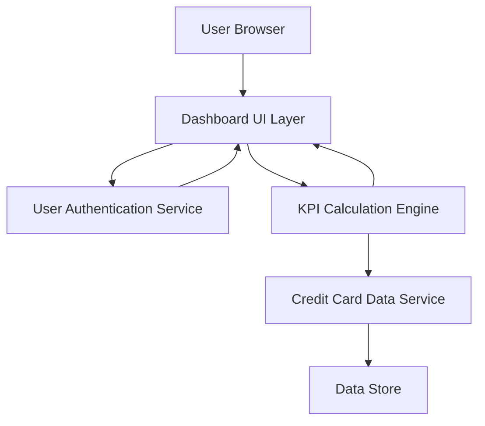

#### 1. High-Level Design

- **Summary:** This epic delivers a consolidated dashboard that displays key performance indicators (KPIs) for all user credit cards in a single view. Core requirements include displaying monthly spend, total credit limit, available credit, and outstanding amounts with real-time visibility. The dashboard provides a comprehensive portfolio overview enabling users to monitor their financial health across multiple cards.

- **Component Flow:**

- **Integration Points:**
  - **Upstream:** User Authentication Service (for secure user access and session management)
  - **Downstream:** Credit Card Data Service (for retrieving card details, balances, and transaction summaries)

- **Key Assumptions:** 
  - Credit Card Data Service provides real-time or near-real-time data with refresh intervals sufficient to meet the 2-second dashboard load requirement.
  - KPI calculations (available credit, utilization) are performed on the frontend or via a lightweight middleware layer using data from the Credit Card Data Service.

- **NFR Highlights:** Dashboard load time must be under 2 seconds; Real-time data refresh for KPI metrics; Responsive design across desktop, tablet, and mobile devices.

#### 2. Validation Report

- **Requirements Coverage:** The design covers all stated scope elements including dashboard KPIs display, multiple credit card view, monthly spend tracking, credit limit aggregation, available credit calculation, outstanding amount display, and responsive layout. The component flow addresses the integration dependencies with Credit Card Data Service and User Authentication Service. All NFRs (2-second load time, real-time refresh, responsive design) are acknowledged in the architecture.