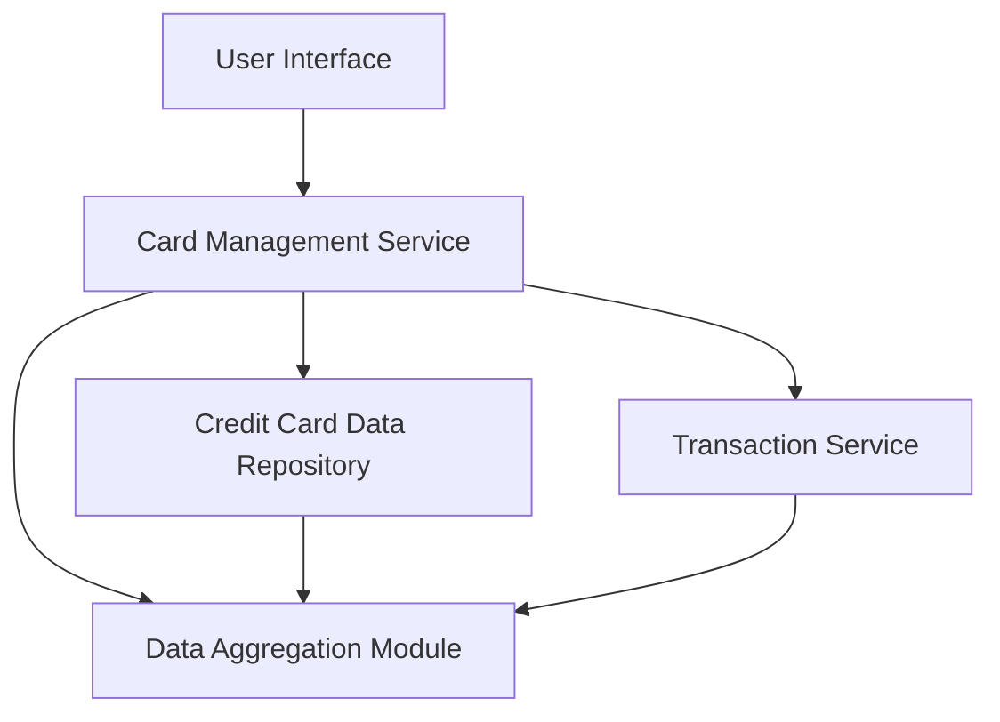

#### 1. High-Level Design

- **Summary:** This epic enables users to manage and view multiple credit cards within a unified interface. Users can view all cards with relevant details, switch between cards, access card-specific information, and perform card-wise spend analysis. The feature consolidates the user's entire credit card portfolio for easy comparison and monitoring.

- **Component Flow:**

- **Integration Points:**
  - **Upstream:** Credit Card Data Repository (stores and retrieves card information)
  - **Upstream:** Transaction Service (provides card-wise transaction data for spend analysis)
  - **Downstream:** No external downstream systems mentioned; serves as the management interface for users.

- **Key Assumptions:**
  - Card data structure is standardized across all cards in the repository, allowing uniform display and switching functionality.
  - Card-wise spend analysis relies on transaction data being tagged with card identifiers for proper aggregation.

- **NFR Highlights:** System must support management of at least 10 credit cards per user; card data retrieval must complete within 1 second per card.

#### 2. Validation Report

- **Requirements Coverage:** The design fully covers the stated scope including credit card listing interface, card detail views, card-wise spend analysis, card switching functionality, card information display, and multi-card data aggregation. The architecture supports the NFRs for managing at least 10 cards per user and the 1-second retrieval time per card. Dependencies on the credit card data repository and transaction service are clearly identified. Out-of-scope items such as real bank integration and card activation/deactivation are appropriately excluded.