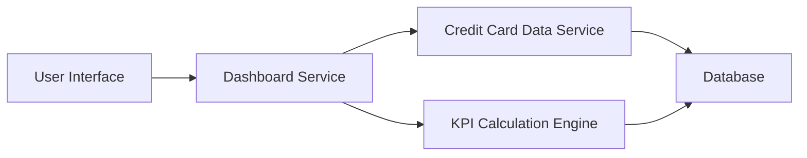

#### 1. High-Level Design

- **Summary:** This epic provides a consolidated dashboard that displays key performance indicators (KPIs) for the user's credit card portfolio. Users can monitor monthly spend, total credit limit, available credit, and outstanding amounts across all cards from a single responsive interface, enabling real-time visibility into financial health and credit utilization.

- **Component Flow:**

- **Integration Points:**
  - **Upstream:** Credit Card Data Service (retrieves card information and transaction data for KPI calculations)
  - **Downstream:** No external downstream systems mentioned; dashboard serves as the end-user presentation layer.

- **Key Assumptions:**
  - KPI calculations (monthly spend, available credit, outstanding amounts) are computed in real-time or near real-time based on current transaction and account data.
  - Credit card data is assumed to be available in a standardized format from the credit card data service.

- **NFR Highlights:** Dashboard must load within 2 seconds; system must support responsive design across desktop and mobile devices; real-time data refresh capability required.

#### 2. Validation Report

- **Requirements Coverage:** The design addresses all scope elements including dashboard interface design, monthly spend calculation, credit limit aggregation, available credit computation, outstanding amount tracking, responsive layout, and multi-card consolidated view. The architecture supports the 2-second load time requirement and responsive design NFRs. Integration with the credit card data service is clearly defined, and the design excludes out-of-scope items such as real bank integration and payment processing.