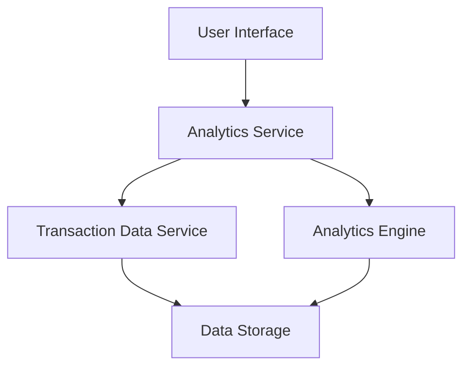

#### 1. High-Level Design

- **Summary:** This epic delivers an interactive analytics module that visualizes user spending patterns across multiple predefined categories (Food & Dining, Fuel, Shopping, Travel, Entertainment, Utilities, Healthcare, Education, Miscellaneous). Users can view monthly spend trends and category-wise breakdowns to identify spending habits and make informed financial decisions.

- **Component Flow:**

- **Integration Points:**
  - **Upstream:** Transaction Data Service (provides categorized transaction history)
  - **Downstream:** Analytics Engine (processes and aggregates spending data for visualization)

- **Key Assumptions:**
  - Transactions are pre-categorized by the transaction data service; no manual categorization logic is required in this epic.
  - Data refresh frequency is assumed to be near real-time or batch-updated daily unless otherwise specified.

- **NFR Highlights:** Analytics visualizations must render within 3 seconds; system must handle 12 months of historical data; charts must be interactive and responsive across all device sizes.

#### 2. Validation Report

- **Requirements Coverage:** The design covers all stated scope items including category-wise visualization, monthly trend analysis, interactive charts, spending pattern identification, multi-category tracking, transaction categorization, and time-period comparisons. The architecture supports the NFRs for rendering performance, historical data retention, and responsive design. Integration dependencies with the transaction data service and analytics engine are clearly identified and addressed.