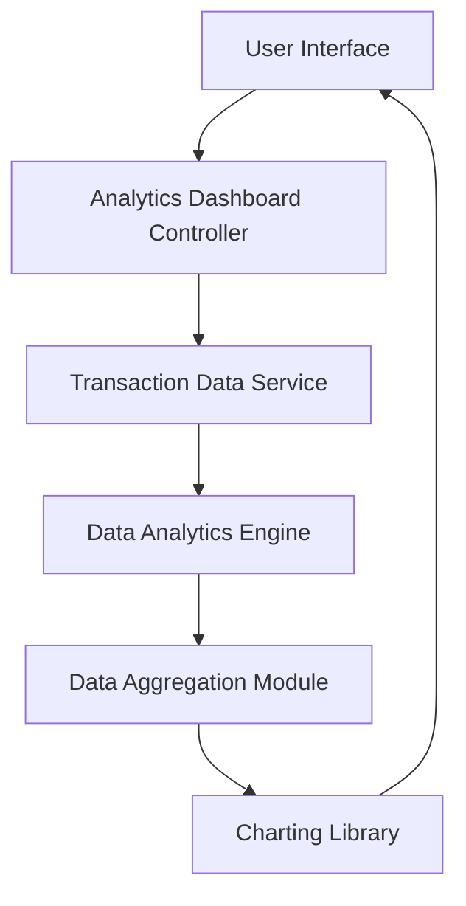

#### 1. High-Level Design

- **Summary:** This epic provides advanced spending analytics with interactive visualizations across nine predefined categories (Food & Dining, Fuel, Shopping, Travel, Entertainment, Utilities, Healthcare, Education, Miscellaneous). Users can analyze monthly trends, identify spending patterns, and drill down into specific categories and time periods through interactive charts and graphs.

- **Component Flow:**

- **Integration Points:**
  - **Upstream:** Transaction data service for retrieving raw transaction records with category tags and timestamps
  - **External:** Charting library (e.g., Chart.js, D3.js, or similar) for rendering interactive visualizations
  - **Internal:** Data analytics engine for aggregation, computation, and trend analysis; Data aggregation module for category-wise and time-period-based grouping

- **Key Assumptions:**
  - Transactions are pre-categorized at ingestion or via a classification service; assuming category tags are already assigned to transaction records.
  - Historical data storage supports at least 12 months of transaction history with efficient query performance; assuming indexed database or data warehouse architecture.

- **NFR Highlights:** Analytics visualizations must render within 3 seconds; system must handle historical data for at least 12 months; charts must be interactive and responsive; data aggregation must be accurate to the cent.

#### 2. Validation Report

- **Requirements Coverage:** The design fully addresses all scope requirements including category-wise spending visualization across all nine specified categories, monthly spend trends analysis, interactive charts and graphs, spending pattern identification, multi-category breakdown, and time-period filtering. The architecture explicitly includes components for transaction data retrieval, analytics computation, data aggregation, and interactive charting. All NFRs are covered: 3-second rendering time is achievable through efficient aggregation and caching; 12-month historical data requirement is addressed in the data service layer; interactivity and responsiveness are handled by the charting library selection; cent-level accuracy is ensured by the aggregation module design. Dependencies on transaction data service, analytics engine, and charting library are explicitly mapped.