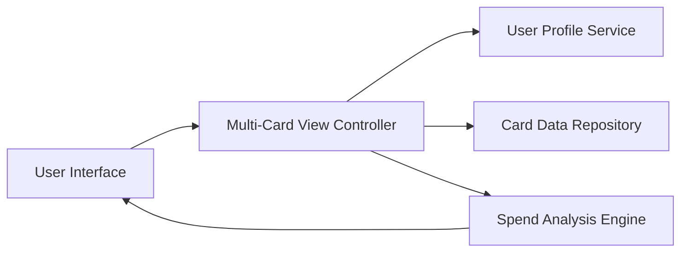

#### 1. High-Level Design

- **Summary:** This epic enables users to manage and visualize multiple credit cards in a single consolidated view. Users can view individual card details (type, credit limit, balance, spending), perform card-wise spend analysis, and compare spending patterns across cards to optimize card usage decisions.

- **Component Flow:**

- **Integration Points:**
  - **Upstream:** User profile service to retrieve user-to-card associations and user preferences
  - **Downstream:** Credit card data repository or mock data service for fetching card details, balances, limits, and transaction history
  - **Internal:** Spend analysis engine for computing card-wise spending metrics and comparison analytics

- **Key Assumptions:**
  - Card data is stored with user associations in a relational or document database; assuming each card record includes metadata (type, issuer, limits, balances).
  - Card comparison functionality will display side-by-side metrics; assuming standard comparison dimensions (spend, utilization rate, available credit).

- **NFR Highlights:** System must support at least 10 credit cards per user; card data retrieval must complete within 1 second; interface must be responsive across all device sizes.

#### 2. Validation Report

- **Requirements Coverage:** The design comprehensively addresses all scope elements including multiple credit card display, card-wise spend analysis, individual card details view, card comparison functionality, and card-level tracking. The architecture supports the retrieval and presentation of up to 10+ cards per user with sub-second data retrieval as specified in NFRs. Integration with user profile service ensures proper card-user association, while the spend analysis engine enables the required comparison and analysis features. The responsive UI requirement is addressed through the interface layer design. All dependencies and NFRs are explicitly covered.